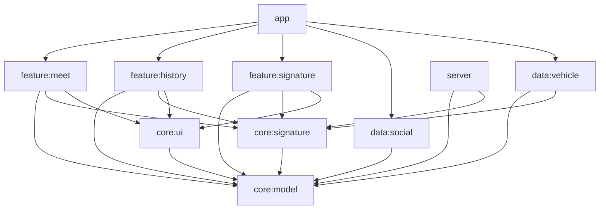
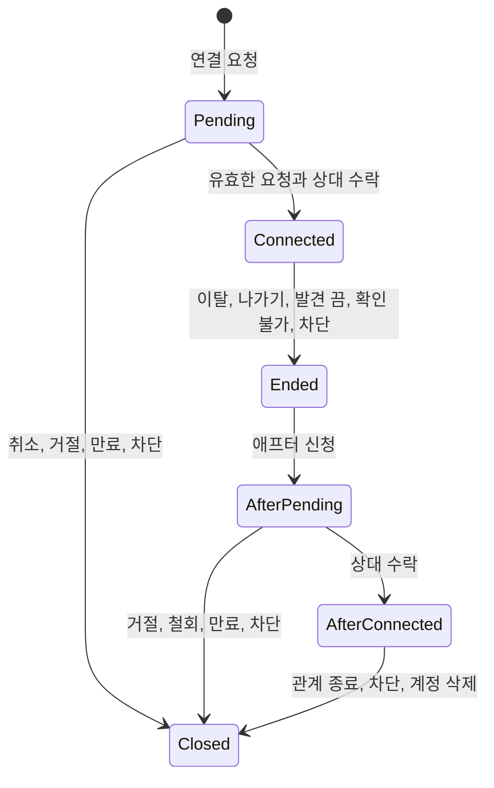

# 아키텍처

차연은 Android 앱과 서버를 함께 두는 모노레포입니다. Gradle 루트는 하나입니다.

## 구조

```txt
chayeon/
  app/               앱 조립, Navigation, 단일 Activity, 알림, 시연 제어
  core/
    model/           도메인 모델, 상태, Repository 인터페이스, API 계약 (순수 Kotlin)
    signature/       시그니처 계산, 칭호, 궁합, 매듭 시드 (순수 Kotlin)
    ui/              테마, 입체 컴포넌트, 매듭, 3D 에셋
  data/
    social/          Fake와 서버 연동 구현
    vehicle/         차량 신호, 주행 기록, 시그니처 저장
  feature/
    meet/            발견, 요청, 일시 연결, 주행 중
    history/         참여 준비, 기록, 애프터, 차단·신고, 정리
    signature/       내 프로필, 내 시그니처, 공개 범위, 주행 후 요약
  server/            Ktor 단일 서버
  fixtures/          가상 사용자, 합성 주행과 위치 시나리오
  scripts/           dev.py, 차량 시나리오 도구
  apk/               제출용 APK
  docs/
```

## 의존 방향



```kotlin
val allowedEdges = mapOf(
    ":app" to setOf(":core:model", ":core:signature", ":core:ui", ":data:social", ":data:vehicle",
        ":feature:meet", ":feature:history", ":feature:signature"),
    ":core:model" to emptySet(),
    ":core:signature" to setOf(":core:model"),
    ":core:ui" to setOf(":core:model"),
    ":data:social" to setOf(":core:model"),
    ":data:vehicle" to setOf(":core:model", ":core:signature"),
    ":feature:meet" to setOf(":core:model", ":core:signature", ":core:ui"),
    ":feature:history" to setOf(":core:model", ":core:signature", ":core:ui"),
    ":feature:signature" to setOf(":core:model", ":core:signature", ":core:ui"),
    ":server" to setOf(":core:model", ":core:signature"),
)
```

- feature는 서로 의존하지 않고 data 모듈도 보지 않습니다. 인터페이스만 보며 구현은 `app`의 `AppGraph`가 넣습니다.
- 차량 SDK와 `android.car`는 `data:vehicle`에서만 씁니다.
- HTTP는 `data:social`에서만 씁니다.
- 위 그래프는 `verifyArchitecture`가 빌드 때 검사합니다.

## 계약

`core:model`이 앱과 서버의 단일 계약입니다.

| 인터페이스 | 역할 |
|---|---|
| `SessionRepository` | 시연 공간 입장, 테스트 계정, 로그아웃, 계정 삭제 |
| `ProfileRepository` | 내 프로필, 참여 설정, 공개 시그니처 게시 |
| `DiscoveryRepository` | 발견 켜기와 끄기, 후보 관찰 |
| `ConnectionRepository` | 요청, 응답, 취소, 현재 연결 관찰, 인사, 종료 |
| `EncounterRepository` | 스친 인연 목록과 상세, 내 기록 삭제 |
| `AfterRepository` | 애프터 신청, 응답, 철회, 후속 대화, 관계 종료 |
| `SafetyRepository` | 차단, 해제, 신고, 차단 목록 |
| `DrivingStateProvider` | `ALLOWED`, `RESTRICTED`, `UNKNOWN` 관찰 |
| `SignatureRepository` | 내 시그니처, 특성 근거, 공개 설정, 주행 후 요약, 주행 제외 |
| `VehicleConsole` | 시연 빌드 전용 기어 전환과 합성 주행 재생 |

모든 비동기 결과는 `AppResult`(성공, 또는 `NotAuthorized`, `AlreadyClosed`, `Expired`, `PeerUnavailable`, `Restricted`, `Network`, `Unknown`)로 돌려줍니다. 상대의 차단 여부 같은 이유는 드러내지 않습니다.

## 상태 전이



요청, 일시 연결, 기록, 애프터 요청, 후속 연결은 별도 엔티티입니다.

- 사용자당 활성 일시 연결은 하나입니다.
- 수락 때 요청 유효성, 당사자, 차단, 발견 상태, 위치 신선도, 근접을 원자적으로 다시 검사합니다.
- 취소, 만료, 종료는 최종 상태입니다.
- 이탈과 상태 확인 불가는 다른 종료 이유입니다. 진입 거리와 종료 거리를 분리하고 이탈 유예를 둡니다.
- 기록은 실제 성립한 연결만 한 번 만듭니다. 위치를 저장하지 않습니다.
- 행위자는 인증 토큰으로 정합니다. 요청 본문의 신원을 믿지 않습니다.
- 모든 상태에 버전이 있어 중복과 역순 이벤트를 버립니다.

## 서버

- **기술:** Ktor, kotlinx.serialization. 저장은 인터페이스 뒤의 메모리 구현입니다.
- **동기화:** 명령은 REST, 상태는 `GET /v1/sync?since=버전` 긴 폴링입니다. 변경이 있으면 바로 응답하고 재접속도 같은 경로로 수렴합니다.
- **시연 공간:** 공간마다 격리됩니다. `혼자 둘러보기`는 앱 안에서 Fake로 돌고, 공개 서버를 쓸 때는 공간마다 `시연용 가상 상대`를 둡니다.
- **위치:** 합성 시나리오나 앱이 보낸 좌표로 근접만 판정합니다. 어떤 응답에도 좌표, 거리, 방향을 넣지 않습니다. 로그에도 남기지 않습니다.
- **빌드:** `-Pchayeon.serverOnly=true`이면 Android 모듈 없이 서버만 빌드합니다. Dockerfile을 제공합니다.
- **배포:** 공개 서버 운영은 별도 결정 사항입니다. 앱은 `chayeon.serverUrl` 값이 있을 때만 서버 모드를 보여줍니다.

## 차량 연동

`data:vehicle`의 `VehicleGateway`가 신호를 흐름으로 냅니다.

| 구현 | 쓰임 |
|---|---|
| `PleosVehicleGateway` | Vehicle SDK 2.3.2와 `CarPropertyManager`. 차량 서비스가 있을 때 |
| `SimulatedVehicleGateway` | 차량 서비스가 없을 때. 시연 제어로 조작. 합성 표시 |

- 속도는 `CarPropertyManager`의 `PERF_VEHICLE_SPEED`로 읽습니다. Vehicle SDK에는 속도 API가 없습니다.
- 기어, 브레이크, 조향, 방향지시등, 벨트, 타이어, 연료, 배터리, 소모품, 공조는 Vehicle SDK로 읽습니다.
- 조향 값은 부호가 입력과 반대인 측정 결과가 있어 크기만 씁니다.
- 각 기능은 `check*Capabilities`로 지원 여부를 먼저 봅니다. 미지원과 권한 오류는 `UNSUPPORTED`로 처리합니다.
- 주행 기록은 포그라운드 서비스에서 돌고, 지표만 SQLite에 저장합니다. 원시 값은 저장하지 않습니다.
- `CarInfo`의 VIN과 CRN API는 호출하지 않습니다.

Pleos 에뮬레이터 측정에서 온 조건입니다. 실차와 App Market 승인은 확인하지 못했습니다.

| 측정 결과 | 설계 |
|---|---|
| P만 제한 없음. D와 N은 0km/h에서도 제한 | `ALLOWED`는 P와 주행 상태 0일 때만 |
| `distractionOptimized` 미선언 화면은 주행 중 가려짐 | 단일 Activity에 선언, 잠금은 앱이 처리 |
| 일반 서비스는 60초 뒤 종료 | 기록과 발견 유지는 포그라운드 서비스 |
| 상단 카드는 `CATEGORY_MESSAGE`만 표시 | 요청과 인사 알림에 사용 |
| 토스트 안 보임, 오버레이 실패 | 앱 밖 안내에 쓰지 않음 |
| 앱 창 1682×1210, 160dpi | 레이아웃 기준 |
| 사용자 ID 10 | adb 명령에 `--user 10` |

## 디자인 구현

- 토큰은 `core:ui`에 모읍니다. 값은 `docs/design/README.md`와 `RedStyle.dc.html`을 따릅니다.
- 글꼴은 Asta Sans(SIL OFL)를 앱에 포함합니다.
- 3D 에셋은 `docs/design/assets/`의 이미지를 `core:ui` 리소스로 씁니다.
- 젤리 버튼, 글래스 카드, 빛나는 공, 아바타 접시는 Canvas와 Brush 레이어로 그립니다. 기본 Material 표면을 쓰지 않습니다.
- 스크린샷 테스트는 Roborazzi로 1682×1210dp에서 돌립니다.

## 도구

| 항목 | 버전 |
|---|---|
| JDK | 17 |
| Gradle | 8.12 |
| Android Gradle Plugin | 8.10.1 |
| Kotlin | 2.1.20 |
| Compose BOM | 2025.04.01 |
| Navigation Compose | 2.9.0 |
| compileSdk, targetSdk | 35 |
| minSdk | 28 |
| 패키지 | `dev.chayeon` |

Vehicle SDK는 `https://nexus-playground.pleos.ai/repository/maven-releases/`의 `ai.pleos.playground:Vehicle:2.3.2`입니다. SDK 파일은 저장소에 넣지 않습니다.

## 검증 명령

| 명령 | 내용 |
|---|---|
| `python3 scripts/dev.py doctor` | 환경 확인 |
| `python3 scripts/dev.py verify` | 구조 검사, 단위 테스트, 서버 테스트, 스크린샷 테스트, lint, 빌드 |
| `python3 scripts/dev.py server` | 로컬 서버 실행 |
| `python3 scripts/dev.py emulator` | Pleos 에뮬레이터 실행 |
| `python3 scripts/dev.py drive <시나리오>` | Virtual Console로 차량 신호 입력 |
| `python3 scripts/dev.py e2e` | 에뮬레이터 종단 검증 |
| `python3 scripts/dev.py release` | 제출용 APK 생성 |
