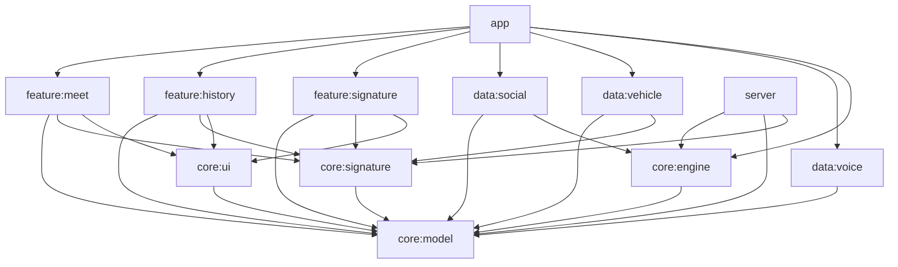
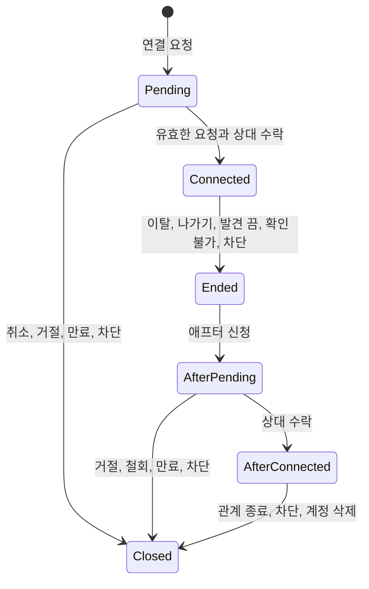

# 아키텍처

차연은 Android 앱과 서버를 함께 두는 모노레포입니다. Gradle 루트는 하나입니다.

## 구조

```txt
chayeon/
  app/               앱 조립, Navigation, 단일 Activity, 알림, 시연 제어
  core/
    model/           도메인 모델, 상태, Repository 인터페이스, API 계약 (순수 Kotlin)
    signature/       시그니처 계산, 칭호, 궁합, 매듭 시드 (순수 Kotlin)
    engine/          서버와 혼자 둘러보기가 함께 쓰는 관계 상태 기계, 시연 상대 (순수 Kotlin)
    ui/              테마, 입체 컴포넌트, 매듭, 3D 에셋
  data/
    social/          기기 안 엔진과 서버 연동 구현
    vehicle/         차량 신호, 주행 기록, 시그니처 저장
    voice/           통화 수명, AudioRecord/AudioTrack, Pleos 데모 음성, 오디오 포커스, 통화 서비스
  feature/
    meet/            발견, 요청, 일시 연결, 주행 중
    history/         참여 준비, 기록, 애프터, 차단·신고, 정리
    signature/       내 프로필, 내 시그니처, 공개 범위, 주행 후 요약
  server/            Ktor 단일 서버
  fixtures/          가상 사용자, 합성 주행과 위치 시나리오
  scripts/           dev.py, 차량 시나리오 도구
  apk/               제출용 APK
  docs/
```

## 의존 방향



```kotlin
val allowedEdges = mapOf(
    ":app" to setOf(":core:model", ":core:signature", ":core:engine", ":core:ui", ":data:social", ":data:vehicle", ":data:voice",
        ":feature:meet", ":feature:history", ":feature:signature"),
    ":core:model" to emptySet(),
    ":core:signature" to setOf(":core:model"),
    ":core:engine" to setOf(":core:model"),
    ":core:ui" to setOf(":core:model"),
    ":data:social" to setOf(":core:model", ":core:engine"),
    ":data:voice" to setOf(":core:model"),
    ":data:vehicle" to setOf(":core:model", ":core:signature"),
    ":feature:meet" to setOf(":core:model", ":core:signature", ":core:ui"),
    ":feature:history" to setOf(":core:model", ":core:signature", ":core:ui"),
    ":feature:signature" to setOf(":core:model", ":core:signature", ":core:ui"),
    ":server" to setOf(":core:model", ":core:signature", ":core:engine"),
)
```

- feature는 서로 의존하지 않고 data 모듈도 보지 않습니다. 인터페이스만 보며 구현은 `app`의 `AppGraph`가 넣습니다.
- 차량 SDK와 `android.car`는 `data:vehicle`에서만 씁니다.
- HTTP/WebSocket 클라이언트는 `data:social`에서만 씁니다. `data:voice`는 `core:model`의 PCM 채널만 사용하며 Android 오디오와 통화 서비스를 소유합니다.
- 관계 규칙은 `core:engine` 한곳에 있습니다. 서버와 `혼자 둘러보기`가 같은 상태 기계를 실행해 두 모드의 동작이 갈라지지 않습니다.
- 위 그래프는 `verifyArchitecture`가 빌드 때 검사합니다.

## 계약

`core:model`이 앱과 서버의 단일 계약입니다.

| 인터페이스 | 역할 |
|---|---|
| `SessionRepository` | 설치별 프로필 입장, 로그아웃, 계정 삭제 |
| `ProfileRepository` | 내 프로필, 참여 설정, 공개 시그니처 게시 |
| `DiscoveryRepository` | 발견 켜기와 끄기, 후보 관찰 |
| `ConnectionRepository` | 요청, 응답, 취소, 현재 연결 관찰, 통화 끊기(leave). 텍스트 메시지 계약 없음 |
| `VoiceCallRepository` | 연결 ID별 통화 상태, 음소거, 주차 중 선택적 마이크 권한 |
| `VoiceTransport`, `VoiceChannel` | data:social이 구현하는 인증 WebSocket PCM 채널 |
| `DemoPeerVoice` (`data:voice` 내부) | 양 모드의 데모 상대 재생·포커스·종료. Pleos 기기 내 음성, 마이크와 WebSocket 없음 |
| `EncounterRepository` | 스친 인연 목록과 상세, 내 기록 삭제 |
| `AfterRepository` | 연락처를 선택한 애프터 신청·응답, 철회, 상호 수락 후 연락처 교환, 관계 종료 |
| `SafetyRepository` | 차단, 해제, 신고, 차단 목록 |
| `DrivingStateProvider` | `ALLOWED`, `RESTRICTED`, `UNKNOWN` 관찰 |
| `SignatureRepository` | 내 시그니처, 특성 근거, 공개 설정, 주행 후 요약, 주행 제외 |
| `VehicleConsole` | 시연 빌드 전용 기어 전환과 합성 주행 재생 |

모든 비동기 결과는 `AppResult`(성공, 또는 `NotAuthorized`, `AlreadyClosed`, `Expired`, `PeerUnavailable`, `Restricted`, `Network`, `Unknown`)로 돌려줍니다. 상대의 차단 여부 같은 이유는 드러내지 않습니다.

## 상태 전이



요청, 일시 연결, 기록, 애프터 요청, 후속 연결은 별도 엔티티입니다.

- 사용자당 활성 일시 연결은 하나입니다.
- 수락 때 요청 유효성, 당사자, 차단, 발견 상태, 위치 신선도, 근접을 원자적으로 다시 검사합니다.
- 취소, 만료, 종료는 최종 상태입니다.
- 이탈과 상태 확인 불가는 다른 종료 이유입니다. 진입 거리와 종료 거리를 분리하고 이탈 유예를 둡니다.
- 기록은 실제 성립한 연결만 한 번 만듭니다. 위치를 저장하지 않습니다.
- 행위자는 인증 토큰으로 정합니다. 요청 본문의 신원을 믿지 않습니다.
- 모든 상태에 버전이 있어 중복과 역순 이벤트를 버립니다.

## 서버

- **기술:** Ktor, kotlinx.serialization. 저장은 기본 메모리이며 `CHAYEON_DATA_DIR` 설정 시 원자적 파일 저장을 사용합니다.
- **동기화:** 명령은 REST, 상태는 `GET /v1/sync?since=버전` 긴 폴링입니다. 변경이 있으면 바로 응답하고 재접속도 같은 경로로 수렴합니다.
- **시연 공간:** 공간마다 격리됩니다. `혼자 둘러보기`는 앱 안에서 같은 엔진을 실행하고, 서버 모드도 공간마다 `시연용 가상 상대`를 둡니다.
- **위치:** 이번 앱 릴리스는 합성 presence로 근접을 판정해요. 기기 위치는 집 보호 비교에만 쓰고 서버로 보내지 않아요. 엔진의 기존 위치 입력 계약은 유지해요. 어떤 응답에도 좌표, 거리, 방향을 넣지 않습니다. 로그에도 남기지 않습니다.
- **빌드:** `-Pchayeon.serverOnly=true`이면 Android 모듈 없이 서버만 빌드합니다. Dockerfile을 제공합니다.
- **배포:** 팀 운영 심사용 서버 구성을 `deploy/`에 제공합니다. 실제 배포와 Docker 런타임 검증은 별도입니다. 앱은 `chayeon.serverUrl` 값이 있을 때만 서버 모드를 보여줍니다.

## 차량 연동

`data:vehicle`의 `VehicleGateway`가 신호를 흐름으로 냅니다.

| 구현 | 쓰임 |
|---|---|
| `PleosVehicleGateway` | Vehicle SDK 2.3.2와 `CarPropertyManager`. 차량 서비스가 있을 때 |
| `SimulatedVehicleGateway` | 차량 서비스가 없을 때. 시연 제어로 조작. 합성 표시 |

- 속도는 `CarPropertyManager`의 `PERF_VEHICLE_SPEED`로 읽습니다. Vehicle SDK에는 속도 API가 없습니다.
- 기어, 브레이크, 조향, 방향지시등, 벨트, 타이어, 연료, 배터리, 소모품, 공조는 Vehicle SDK로 읽습니다.
- 조향 값은 부호가 입력과 반대인 측정 결과가 있어 크기만 씁니다.
- 각 기능은 `check*Capabilities`로 지원 여부를 먼저 봅니다. 미지원과 권한 오류는 `UNSUPPORTED`로 처리합니다.
- 주행 기록은 포그라운드 서비스에서 돌고, 지표만 SQLite에 저장합니다. 원시 값은 저장하지 않습니다.
- `CarInfo`의 VIN과 CRN API는 호출하지 않습니다.

주행 정책은 권한이 필요 없는 `CarUxRestrictionsManager`의 변경 리스너와 현재 제한 조회를 사용해요. 신선한 SDK 기어 P와 `isRequiresDistractionOptimization=false`가 함께 확인될 때만 허용해요. D/N/R 또는 DO 요구는 제한이며, 관찰 오류·2.5초 초과·차량 서비스 연결 해제는 UNKNOWN이에요. `CAR_DRIVING_STATE` 권한과 shell 권한 대여는 사용하지 않아요.

`ChayeonApplication`은 `VehicleGraph`, `SocialGraph`, `SignaturePublisher`, `AppEvents`, `AutoConnectCoordinator`를 소유해요. 세션·서버의 차량 데이터 동의가 기록 게이트를 결정해요. 이 서비스용 동의는 주행 중에도 관찰되며 화면용 프로필과 분리되어 있어요. Android 14 서비스는 Activity가 전경일 때 시작해요. 동의가 철회되면 기록을 멈추고, 발견·연결·집 보호도 필요 없으면 서비스를 끝내요. `CAR_SPEED`·`CAR_ENERGY`는 동의 뒤 런타임에 요청해요. 거부한 신호는 UNSUPPORTED로 남아요.

로그아웃과 삭제는 게이트를 먼저 닫고 게시 작업과 직렬화한 뒤 소셜 저장소의 정리 영수증 경로를 실행해요. 공개 투영 변경은 `SignaturePublisher`가 게시·철회하고 같은 명령으로 재시도해요. 화면은 현재 세션의 등록 상태로 복원되며 주행 중 알림은 연락처 내용 없는 `CATEGORY_MESSAGE`예요.

Pleos 에뮬레이터 측정에서 온 조건입니다. 실차와 App Market 승인은 확인하지 못했습니다.

| 측정 결과 | 설계 |
|---|---|
| P만 제한 없음. D와 N은 0km/h에서도 제한 | `ALLOWED`는 신선한 P와 UX 제한의 Requires DO=false일 때만 |
| `distractionOptimized` 미선언 화면은 주행 중 가려짐 | 단일 Activity에 선언, 잠금은 앱이 처리 |
| 일반 서비스는 60초 뒤 종료 | 기록과 발견 유지는 포그라운드 서비스 |
| 상단 카드는 `CATEGORY_MESSAGE`만 표시 | 내용 없는 요청 알림에 사용 |
| 토스트 안 보임, 오버레이 실패 | 앱 밖 안내에 쓰지 않음 |
| 앱 창 1682×1210, 160dpi | 레이아웃 기준 |
| 사용자 ID 10 | adb 명령에 `--user 10` |

## 디자인 구현

- 토큰은 `core:ui`에 모읍니다. 값은 `docs/design/README.md`와 `RedStyle.dc.html`을 따릅니다.
- 글꼴은 Asta Sans(SIL OFL)를 앱에 포함합니다.
- 3D 에셋은 `docs/design/assets/`의 이미지를 `core:ui` 리소스로 씁니다.
- 젤리 버튼, 글래스 카드, 빛나는 공, 아바타 접시는 Canvas와 Brush 레이어로 그립니다. 기본 Material 표면을 쓰지 않습니다.
- 스크린샷 테스트는 Roborazzi로 1682×1210dp에서 돌립니다.

## 도구

| 항목 | 버전 |
|---|---|
| JDK | 17 |
| Gradle | 8.12 |
| Android Gradle Plugin | 8.10.1 |
| Kotlin | 2.1.20 |
| Compose BOM | 2025.04.01 |
| Navigation Compose | 2.9.0 |
| compileSdk, targetSdk | 35 |
| minSdk | 28 |
| 패키지 | `dev.chayeon` |
| Pleos 데모 음성 | TextToSpeech SDK 3.3.1, ON_DEVICE |

Vehicle SDK는 `https://nexus-playground.pleos.ai/repository/maven-releases/`의 `ai.pleos.playground:Vehicle:2.3.2`입니다. SDK 파일은 저장소에 넣지 않습니다.

## 검증 명령

| 명령 | 내용 |
|---|---|
| `python3 scripts/dev.py doctor` | 환경 확인 |
| `python3 scripts/dev.py verify` | 구조 검사, 단위 테스트, 서버 테스트, 스크린샷 테스트, lint, 빌드 |
| `python3 scripts/dev.py server` | 로컬 서버 실행 |
| `python3 scripts/dev.py emulator` | Pleos 에뮬레이터 실행 |
| `python3 scripts/dev.py drive <시나리오>` | Virtual Console로 차량 신호 입력 |
| `python3 scripts/dev.py e2e` | 에뮬레이터 종단 검증 |
| `python3 scripts/dev.py release` | 제출용 APK 생성 |

## 제출 빌드와 종단 검증

- `python3 scripts/dev.py release`는 R8·리소스 축소를 적용한 설치용 APK를 `apk/chayeon-release.apk`에 복사해요. `CHAYEON_SERVER_URL` 환경 변수로 서버 주소를 주입하며, 생략하면 비어 있고 `chayeon.demo=true`예요. 네트워크 없이 SOLO 엔진과 가상 상대를 사용할 수 있어요.
- 설치용 서명은 무시된 `build/signing/`에서 로컬 키와 난수 비밀번호를 생성해요. 저장소에 서명 키를 넣지 않아요. 개발용 키이므로 실제 마켓 배포 서명과 달라요.
- `-Pchayeon.serverUrl=http://10.0.2.2:<port>` 또는 선택한 기기의 `adb reverse`를 쓰는 `http://127.0.0.1:<port>` debug 구성에서만 해당 로컬 호스트의 cleartext를 허용해요. 기본 debug는 cleartext를 거부하고 release는 localhost·127.0.0.1·::1에만 허용해요. 공개 서버 주소는 HTTPS를 사용해요.
- `python3 scripts/dev.py e2e`는 자동 감지한 실행 중 에뮬레이터, 사용자 10에 정상 설치하고 실제 UI를 조작해요. `--with-real-drive`는 실제 플랫폼 신호를 3분 이상 입력하는 추가 경로예요. 화면·검증 결과는 무시된 `build/e2e/`에 남아요. 에뮬레이터를 시작하거나 종료하지 않아요.
- 시연 콘솔은 `BuildConfig.DEMO_CONTROLS_ENABLED`로 열며 디버그 여부에 의존하지 않아요. 주행 시나리오는 `fixtures/drive` 한곳에서 assets와 CLI에 공급해요.

## 기기 안의 집 보호 구역

`HomeZoneRepository`는 좌표 없는 기기 전용 계약이에요. `data:vehicle`의 순수 `HomeZoneEvaluator`가 신선도·정확도·히스테리시스를 판정하고 `LocalHomeZoneRepository`가 기존 SQLite의 `home_zone`에 계정별로 흔든 중심만 저장해요. 집 기록은 시그니처 동의와 독립적이며 로그아웃·삭제의 로컬 정리 훅에서 함께 지워요. 백업은 계속 꺼져 있어요.

`PlatformHomeLocationProvider`는 정밀 위치 권한을 받은 뒤 `LocationManager`를 구독해요. 현재 fix가 5초 미만이면 정확도가 더 나쁜 새 fix는 무시해요. 좋은 fix가 오래되면 낮은 정확도의 fix도 기존의 보수적인 판정에 사용해요. 위치는 기기 안 비교에만 쓰며 이번 릴리스에서 `UpdateLocation`을 호출하지 않아요. `VehicleRecordingService`는 기존 주행 기록 외에도 발견·활성 연결·집 보호를 유지해요. Activity 전경에서 시작하고 필요한 경우 `dataSync|location` 타입으로 올려 화면이 꺼진 뒤에도 관찰해요.

Application 소유 `HomeZoneCoordinator` 한곳만 presence를 전송해요. `prepareSession`은 계정의 집을 읽은 뒤 세션을 공개하며 네트워크 응답은 기다리지 않아요. 보호 상태에는 기존 `SetSyntheticPresence(AWAY)`, 그 밖에는 선택한 presence를 보내요. 전송 중에는 조정기 잠금을 잡지 않아 세션 시작·종료·현재 확인을 막지 않아요. 전송·재시도 직전 계정과 보호 상태를 다시 확인하고, 보호 전환 시 오래된 시도를 취소해요. 보호 명령은 같은 키로 최대 30초 간격까지 지수 재시도해요. 서버 세션의 성공한 NEARBY는 20초마다 새 키로 갱신해요. AWAY에는 heartbeat가 없으며 세션 종료 시 모두 멈춰요. heartbeat 실패는 화면 오류로 내보내지 않아요.

서버의 `chayeonModule()`은 60초 presence lease를 켜요. NEARBY 명령이 기한을 늘리지만 이미 NEARBY인 갱신은 버전이나 long-poll을 깨우지 않아요. 기한 만료는 서버 ticker에서 명시적 AWAY와 같은 경로로 처리하며 CHECKING → 유예 → DISTANCE로 끝나요. DemoCast는 제외해요. `EnginePolicy.presenceLeaseMillis = null`인 로컬 엔진은 기존 동작을 유지해요. 앱 종료·차량 전원 종료·통신 단절 뒤에도 발견 가능 상태는 최대 lease 길이만큼 남을 수 있고, 연결 종료에는 기존 유예 시간이 추가돼요.

응답을 기다리는 동안 `HomeProtectedDiscoveryRepository`는 후보를 숨기고 발견 ON을 presence 확인 뒤에만 보내요. `HomeProtectedConnectionRepository`는 보호 중 요청·수락을 막고 거절·취소·나가기는 그대로 전달해요. `SocialAfterRepository`도 같은 수락 허용 조건을 주입받아 애프터 ACCEPT의 실제 전송·재시도 직전에 확인하며 거절·관계 종료는 유지해요. 활성 세션의 프로필을 아직 받지 못해도 홈과 내 프로필의 로컬 설정에 접근할 수 있어요. 발견 토글은 조정기가 바꾸지 않아요.

좌표와 반경은 서버로 보내지 않으며 엔진·서버에는 집 개념을 추가하지 않아요. 상대는 집 보호, 앱 종료, 차량 전원 종료, 통신 단절에서 같은 거리 이탈 화면을 봐요. 다만 서버 운영자는 명시적 AWAY가 도착했음을 볼 수 있어요. 이번 빌드에는 실제 위치 기반 이탈이 없어 집 보호 때문이라고 추측할 수 있어요. `data:social`의 내부 presence 명령은 주행 제한 중에도 실행되며 사람이 누르는 콘솔과 집 설정은 현재 정책을 다시 확인해요.

종단 도구는 `--serial`, `CHAYEON_EMULATOR_SERIAL`, `ANDROID_SERIAL` 순서로 선택을 우선해요. 지정한 기기가 사라지면 다른 기기로 바꾸지 않아요. 지정이 없으면 실행 대수와 무관하게 AVD 이름이 `Pleos_Connect_v2_0`인 한 대만 자동 선택하며, 없거나 둘 이상이면 명시적 선택을 요청해요. 선택한 serial의 부팅 완료를 기다리고 설치·셸·포트 전달을 모두 그 기기로 제한해요. 에뮬레이터를 시작하거나 종료하지 않아요. 모의 ADB 선택·격리 테스트도 `verify`에 포함해요.

## 일시 연결 통화

`ChayeonApplication`이 통화 조정기를 소유하고 세션·연결·집 보호·마이크 권한을 관찰해요. CONNECTED에 자동 참여하며 CHECKING, ENDED, 세션 종료, 집 보호 진입에서는 녹음·재생·서비스를 정리해요. 통화 끊기는 기존 leave 명령이며 네트워크 응답 전에 로컬 오디오를 닫아요. 애프터에는 통화를 추가하지 않아요.

서버의 `/v1/voice/{connectionId}`는 Bearer 토큰을 인증하고 엔진의 현재 연결 당사자만 허용해요. 16 kHz mono PCM16의 20 ms/640 byte 프레임을 상대 한 명에게만 보내요. 대기열은 5프레임(100 ms)이고 넘치면 오래된 프레임을 버려요. 초당 50프레임 예산과 최대 50프레임 버스트를 허용하고, 순간 초과는 버리되 통화는 유지해요. 잘못된 프레임 크기 또는 초당 100프레임 초과가 연속 5개 1초 구간에서 관찰될 때 해당 소켓을 닫아요. 재접속에도 참가자의 예산과 과부하 관측을 유지해요. 참가자 검증은 입장·명령·엔진 revision·250ms ticker에서 하고, 프레임 중계와 writer에서는 엔진 export나 전체 재검증을 실행하지 않아요. 음성은 저장 모델과 동기화 DTO에 들어가지 않아요.

마이크를 사용할 수 없으면 수신만 유지해요. Android 14에서 RECORD_AUDIO 없이 microphone 타입 서비스를 시작할 수 없으므로 수신 전용·데모 상대 통화는 mediaPlayback 타입을 사용하고, 녹음 가능한 통화에는 microphone 타입을 함께 사용해요. 알림은 CATEGORY_CALL이며 통화 끊기 action이 같은 leave 경로를 실행해요. 실차 오디오 라우팅과 Pleos 백그라운드 유지·권한 승인은 별도 검증 대상이에요.

데모 상대의 음성은 `data:voice`의 `ScriptedDemoPeerVoice` → `DemoSpeechEngine` → `PleosSpeechEngine`에서 처리해요. Pleos TextToSpeech 3.3.1을 직접 호출하고 `Mode.ON_DEVICE`만 사용해요. 일반 권한 `pleos.car.permission.TTS_SERVICE`만 선언하며 보안 그룹은 추가하지 않아요. SOLO 또는 `ProfileKind.DEMO_PEER`이면 서버 모드에서도 음성 WebSocket·마이크를 열지 않아요. 초기 prepare로 SDK를 준비한 뒤 포커스 아래에서 세 문장을 순서대로 재생하고, 시작 시각 기준 약 20초 간격을 둬요. 실제 소리 시작을 검증하지 못하므로 SDK 시작 콜백으로 발화 UI를 바꾸지 않아요. 종료·보호·포커스 상실은 재생을 멈춰요.

## 인연과 연락처 경계

하단 이동은 `홈 · 인연 · 내 프로필`이며 `인연`은 한 사람당 한 행인 하나의 목록이에요. 받은 애프터는 상단 빨간 배지, 이어진 관계는 하트, 보낸 신청은 `답을 기다려요`, 스친 관계는 기본 행으로 구분해요. 내부 탭은 없어요. `ContactIds`는 선택적인 카카오톡·인스타그램 ID 값 객체예요. 내 프로필의 저장 ID는 본인에게만, 개별 애프터에서 선택한 ID는 양측 수락 뒤 현재 후속 연결의 두 당사자에게만 보여요. 공개 프로필·후보·요청·기록과 알림에는 넣지 않아요. 관계 종료·차단·계정 삭제 뒤 스냅샷과 명령 재시도 결과에도 교환 ID가 남지 않아요. ALLOWED가 아니면 연락처와 인연 기록·QR을 숨겨요.


## 주행 중 조건부 자동 연결

`AutoConnectCoordinator`는 Application에서 동작하며 화면의 주행 제한을 풀지 않아요. `SocialGraph.autoConnectSnapshot`은 개인 연락처와 주행 근거를 제외한 서비스 전용 상태를 제공해요. 조정기는 AUTO 설정·공개 점수 조건·공통 관심사·현재 주행 정책·집 보호를 평가하고 기존 요청/수락 명령에 자동 실행 표시를 붙여요. `data:social`은 실제 전송과 재시도 직전에 현재 정책·설정·조건·차단·활성 연결을 다시 확인하고, 엔진은 저장된 AUTO 동의와 공개 조건을 검사해요. 서버가 상대를 골라 주지는 않아요.

계정별 `PrivateAutoConnectStore`는 백업 제외 영역에 당일 상대별 재시도 금지, 통화 종료 후 10분 대기, 재시도용 멱등 명령, 안내한 연결 ID를 원자적으로 저장해요. 저장을 확인할 수 없으면 자동 실행을 막아요. 점수는 `core:signature`에서만 계산하고 개인 근거는 `data:vehicle`에만 보관해요. 새 모듈이나 의존 방향을 추가하지 않았어요. 자동 통화는 요청 출처가 포함된 스냅샷으로 확인한 뒤 기존 `data:voice`의 Pleos ON_DEVICE 음성으로 연결 사실만 한 번 알려요.

## 설치별 계정과 심사용 운영

계정 선택 없이 설치 하나가 빈 프로필 하나를 만듭니다. 서버는 설치별 비밀 값의 해시와 공간으로 행위자를 결정하며 기본 공간은 `default`입니다. 계정 삭제 후 같은 비밀 값으로 입장해도 삭제된 프로필을 복원하지 않습니다. 재시작 때 진행 중 연결을 종료하며 관계·동의·아직 만료되지 않은 대기 요청을 복원합니다. bearer token은 원문 대신 digest로 저장합니다. 영속 저장의 유휴 공간은 계정과 최대 공간 예산을 유지하고 토큰만 만료하며 메모리 모드만 유휴 공간을 퇴거합니다. 정원·요청 제한·HTTPS·백업과 초기화는 [배포 안내](../deploy/README.md)를 따릅니다.
