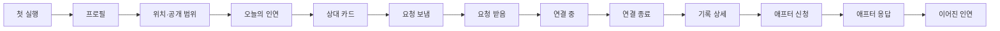

# 차연 디자인 시안

- **캔버스:** https://claude.ai/artifact/1B2DXjvqPQRPy2MM2kXV13 (비공개)
- **채택 페이지:** `D · 블랙 레드 입체`
- **기준일:** 2026-11-03
- **화면 규격:** 1600×1280 차량 화면, 1:1 창은 840×1280

기존 v1의 원본은 캔버스입니다. UI v2와 다른 값은 아래 UI v2 기준이 우선합니다. 이 폴더는 2026-11-03 시점의 사본입니다. 통화 화면은 기존 `RedConnected` 계열의 토큰과 구성을 따르되, 메시지 영역을 통화 중심 화면과 주차 중 읽기 전용 `이야깃거리`로 바꿔요. 주행 중에는 이야깃거리를 숨기고 음소거·통화 끊기만 표시해요. 상세한 차이는 [통화 경험 명세](../product/experience-spec.md#연결은-통화예요)를 따릅니다. 기록·애프터의 별도 하단 이동과 대화 UI는 `인연`의 사람별 통합 목록과 연락처 교환 화면으로 바꿔요. ID 선택·상호 수락·인스타그램 QR·주행 중 숨김은 [인연과 연락처 교환 명세](../product/experience-spec.md#인연과-연락처-교환)를 따릅니다.

## UI v2 기준과 적용 범위

승인된 `design-v2/render`의 Main·Request·CallParked·CallDriving·IncomingDriving·HomeZone·Ended·After·Onboarding·Bonds·MyProfile·TraitDetail·ProfileBuilding·DriveSettings HTML과 PNG가 UI v2의 시각 기준이에요. 기준 창은 **1682×1210dp, 160dpi, 1px = 1dp**예요. 이 목업과 다른 `screens/Red*.dc.html`의 값은 UI v2에서 대체해요. 주행 정책·개인정보·최소 글자와 터치 크기는 제품 명세를 계속 따라요.

첫 적용은 `core:ui`의 장면, 모찌, 아바타, 통화 히어로, 타입·표면·버튼·행과 `app` 크롬이에요. 기능 화면 전체 재배치는 다음 화면 작업에서 진행해요. 공용 기반 적용 후에도 기존 본문 구조는 남아 있어요. 모든 글자는 20sp 이상, 터치는 76dp 이상(주행 컨트롤 96dp 이상)으로 목업의 작은 배지·버튼 값을 보정해요. blur는 플랫폼 의존 없이 Brush 레이어로 근사하고 주행 장식 애니메이션은 없어요.

[구현·검증 보고](ui-v2-foundation.md), [공용 API와 화면 조립 안내](../../core/ui/README.md#ui-v2-공용-기반), [생성 에셋과 프롬프트 출처](assets-v2.md)를 참고하세요. 앱에는 변환된 WebP만 넣고 원본 PNG는 포함하지 않아요.

## 디자인 방향

블랙, 레드, 화이트에 1순위 작품의 입체적인 다크 글래스 문법을 더했습니다. 말랑한 형태와 광택으로 사랑스러운 인상을 만듭니다.

핵심 장치는 **붉은 실**입니다. 실의 모양이 곧 연결 상태를 나타냅니다.

| 실의 모양 | 상태 | 에셋 |
|---|---|---|
| 뻗음 | 요청 대기 | `thread-reach.webp` |
| 이어짐 | 일시 연결 | `thread-taut.webp` |
| 끊김 | 연결 종료 | `thread-cut.webp` |
| 구슬 | 애프터 대기 | `thread-wait.webp` |
| 매듭 | 이어진 인연 | `thread-knot.webp` |

## 화면

`screens/`의 파일은 디자인 캔버스 형식(`.dc.html`)의 편집 원본입니다. 캔버스 런타임과 에셋 저장소에 의존하므로 브라우저에서 바로 열어 보는 용도가 아닙니다. 화면은 캔버스에서 확인하세요.

| 기획 화면 | 화면 | 파일 |
|---|---|---|
| 브랜드 | 키비주얼 | `RedKeyVisual.dc.html` |
| DS01 참여 준비 | 첫 실행 | `RedFirstRun.dc.html` |
| | 프로필 등록·편집 | `RedProfileSetup.dc.html` |
| | 위치·공개 범위 | `RedConsent.dc.html` |
| DS02 발견 | 오늘의 인연 (발견 켜기/끄기) | `RedHome.dc.html` |
| DS03 요청 | 상대 카드 | `RedCandidate.dc.html` |
| | 요청 보냄 (A 계정) | `RedRequestSent.dc.html` |
| | 요청 받음 (B 계정) | `RedRequestIncoming.dc.html` |
| DS04 일시 연결 | 연결 중 | `RedConnected.dc.html` |
| | 연결 중, 주행 제한 | `RedConnectedDriving.dc.html` |
| | 연결 중, 1:1 창 | `RedConnectedNarrow.dc.html` |
| | 연결 종료 (사유 5종) | `RedEnded.dc.html` |
| DS05 기록 | 스친 인연 | `RedEncounters.dc.html` |
| | 기록 상세 | `RedEncounterDetail.dc.html` |
| DS06 애프터 | 애프터 신청 (A 계정) | `RedAfterRequest.dc.html` |
| | 애프터 응답 (B 계정) | `RedAfterIncoming.dc.html` |
| | 이어진 인연 | `RedAfterConnected.dc.html` |
| DS07 설정 | 내 정보 | `RedSettings.dc.html` |
| | 차단·신고 | `RedBlockReport.dc.html` |
| | 기록·계정 정리 | `RedCleanup.dc.html` |
| 기준 | 상태 모음, 발견 | `RedStatesDiscover.dc.html` |
| | 상태 모음, 요청·연결·애프터 | `RedStatesConnect.dc.html` |
| | 색·글자·컴포넌트 | `RedStyle.dc.html` |

주요 흐름은 다음 순서로 이어집니다.



## 디자인 기준

### 색

| 이름 | 값 | 용도 |
|---|---|---|
| 바탕 | `#070304` | 화면 바탕 |
| 깊은 와인 | `#3A0710` | 메인 패널 |
| 딥 레드 | `#A50A23` | 버튼 아래쪽 그라데이션, 흰 버튼의 글자 |
| 메인 레드 | `#D5102F` | 기본 버튼, 실 |
| 빛나는 레드 | `#FF4A5E` | 버튼 위쪽 그라데이션, 토글 |
| 강조 글자 | `#FF9AA6` | 현재 메뉴, 강조 아이콘 |
| 보조 글자 | `#F3D4D9` | 설명 문장 |
| 화이트 | `#FFFFFF` | 제목, 흰 버튼, 주의 배너 |

주의 표시는 빨강이 경고와 브랜드로 겹치지 않도록 흰색 배너로 구분합니다.

### 글자

Asta Sans 한 가지를 씁니다. 최소 크기는 20px입니다.

| 역할 | 크기 | 굵기 |
|---|---|---|
| 히어로 | 56~84 | 800 |
| 큰 제목 | 44~54 | 800 |
| 구역 제목 | 28~38 | 800 |
| 본문 | 25~29 | 500 |
| 보조 | 21~24 | 400 |

## 3D 에셋

`assets/`의 이미지는 `tools/render-assets.mjs`로 직접 렌더링했습니다. 화면 파일은 캔버스 에셋 저장소의 주소를 사용합니다.

| 파일 | 용도 | 캔버스 에셋 주소 |
|---|---|---|
| `kv.jpg` | 키비주얼, 메인 패널 | `/_blob/fd558eefa8337e514bbb8c30c397f764` |
| `logo.jpg` | 로고 | `/_blob/e8be9c615cadd646113cdbd6506c915b` |
| `thread-taut.webp` | 실: 이어짐 | `/_blob/02c94817e16fd7cb7629fe16b54d428b` |
| `thread-reach.webp` | 실: 뻗음 | `/_blob/976f6371700bffc072145686ec18e87d` |
| `thread-wait.webp` | 실: 구슬 | `/_blob/a6fa7857596e175a368c107018c198e2` |
| `thread-cut.webp` | 실: 끊김 | `/_blob/119fab748dadabbe445f47cdc18d20ee` |
| `thread-knot.webp` | 실: 매듭 | `/_blob/152ea35bad46242bcf3889aacbd50f7d` |
| `thread-ribbon.webp` | 패널 하단 장식 | `/_blob/329b012083fc4c594e7d14aeffe64450` |
| `av-dawn.webp` | 아바타: 새벽드라이브 | `/_blob/0f904edde89f1735c44ed93beec99bb1` |
| `av-slow.webp` | 아바타: 느린오후 | `/_blob/c6f3bc14f5339443dc40ef660adcf415` |
| `av-jazz.webp` | 아바타: 재즈한잔 | `/_blob/4016572205c37833d7bdd88c57a3d6e4` |
| `av-sea.webp` | 아바타: 바다보러가요 | `/_blob/a56219198cbe1e2bf511644706f7f11b` |
| `av-forest.webp` | 아바타: 숲길산책 | `/_blob/0f3091f5366b2936b5a3fd9791755cdc` |
| `av-star.webp` | 아바타: 별보는밤 | `/_blob/e656d9d0d2a0c82029ccd6b9fa1a0b34` |

다시 렌더링하려면 Node.js로 원본 PNG를 만든 뒤 ImageMagick으로 줄입니다. 대상은 `all`, `threads`, `avatars`, `kv` 중에서 고릅니다.

```sh
node docs/design/tools/render-assets.mjs /tmp/chayeon-render all
magick /tmp/chayeon-render/kv.png -resize 1280x1280 -quality 88 kv.jpg
magick /tmp/chayeon-render/kv.png -crop 1040x1040+504+80 +repage -resize 240x240 -quality 90 logo.jpg
magick /tmp/chayeon-render/thread-taut.png -resize 1600x320 -quality 88 thread-taut.webp
magick /tmp/chayeon-render/thread-ribbon.png -resize 1536x90 -quality 88 thread-ribbon.webp
magick /tmp/chayeon-render/av-dawn.png -resize 512x512 -quality 90 av-dawn.webp
```

## 결정과 남은 일

| 항목 | 상태 |
|---|---|
| 색 방향 | 블랙, 레드, 화이트로 결정 |
| 아바타 | 찹쌀떡 캐릭터로 진행. 실제 사람처럼 보이지 않아 가상 프로필 기획과 맞습니다 |
| 렌더링 검수 | 3D 에셋은 확인했지만, 전체 화면의 렌더링과 클릭 동작은 아직 확인하지 않았습니다 |
| 임시 값 | 요청 응답 시간, 애프터 응답 기한, 관심사 최대 개수는 확정 사양이 아닙니다 |
| 미정 값 | 신고 기록 보관 기간은 화면에 `[보관 기간]`으로 표시했습니다 |
| 이전 안 | 캔버스의 A 딥 로즈, B 블랙 레드, C 러블리 핑크는 비교용으로 남겨 두었습니다 |
| 야간 시인성 | 실제 차량 화면에서 밝기와 대비를 확인해야 합니다 |
| 화면 크기 | 에뮬레이터의 앱 창은 1682×1210으로 시안보다 세로가 짧습니다. 구현 때 레이아웃을 맞춰야 합니다 |
