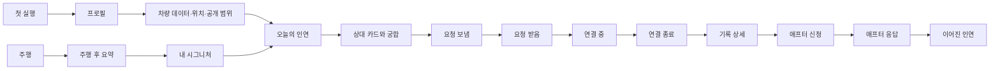

# 경험 명세

화면, 동작, 상태의 기준입니다. 시각 기준은 `docs/design/screens/Red*.dc.html`이고, 값은 그 파일의 인라인 스타일에서 그대로 가져옵니다. 이 문서는 시안과 달라지는 점과 시안에 없는 화면을 정의합니다.

## 시안에서 바꾸는 점

| 항목 | 시안 | 구현 | 이유 |
|---|---|---|---|
| 상단 줄 | 시각, 기어, 5G, 합성 위치 | **시각과 5G 제거.** 기어 상태(`P 주차 중`, `D 주행 중`)를 표시해요. 주차 화면의 `시연 제어`는 작은 아이콘 버튼이며, `합성 위치`는 서버 모드에서만 표시해요 | 시각과 통신 상태는 차량 시스템 UI가 보여줍니다 |
| 기준 크기 | 1600×1280 | **1682×1210dp**에 맞춤 | Pleos 앱 창 실측값. 160dpi라 1dp = 1px입니다 |
| 세로 여유 | 넉넉함 | 패널 높이를 줄여 넘치지 않게 조정 | 창이 70dp 낮습니다 |
| 좁은 창 | 연결 중만 840폭 | 폭 1100dp 미만이면 모든 화면이 한 열로 쌓이고 스크롤 | 화면 분할 대응 |
| 참여 준비 하단 | 프로필·공개 범위의 `이전` 버튼 | 세 단계와 프로필 편집 모두 기본 버튼 하나를 콘텐츠 전체 너비로 표시해요. 단계 전환·스크롤에도 위치를 유지해요. 뒤로가기는 상단 원형 버튼과 시스템 뒤로가기를 사용하며 기존 주행 잠금 규칙을 유지해요 | 중복 뒤로가기와 첫 단계의 빈 슬롯 제거 |
| 프로필 | 닉네임, 아바타, 관심사 | 시그니처가 먼저, 관심사는 그다음 | 차량 특화 핵심 |
| 내 정보 | 프로필과 설정 | `내 프로필`로 바꾸고 매듭과 칭호를 앞세움 | 같음 |

## 전체 흐름

## 화면 목록

### 시안이 있는 화면

| 화면 | 모듈 | 시안 | 추가 사항 |
|---|---|---|---|
| 첫 실행 | `feature:history` | `RedFirstRun` | `혼자 둘러보기(가상 상대)`와 `두 대로 연결(서버)` 선택 추가. 서버 주소가 없으면 두 번째를 숨김 |
| 프로필 등록·편집 | `feature:history` | `RedProfileSetup` | 저장 실패와 재시도 |
| 차량 데이터·위치·공개 범위 | `feature:history` | `RedConsent` | 차량 데이터 동의와 선택 마이크 권한 행 추가 |
| 오늘의 인연 | `feature:meet` | `RedHome` | 카드에 칭호, 대표 특성, 잘 맞는 점 수 |
| 상대 카드 | `feature:meet` | `RedCandidate` | 매듭, 특성, 궁합 |
| 요청 보냄, 요청 받음 | `feature:meet` | `RedRequestSent`, `RedRequestIncoming` | 칭호와 잘 맞는 점. 응답 기한 실제 카운트다운. `수락하면 바로 통화가 연결돼요` |
| 연결 중 | `feature:meet` | `RedConnected` | 두 아바타와 통화 상태, 음소거·통화 끊기가 중심. 주차 중 읽기 전용 이야깃거리 |
| 연결 중, 주행 제한 | `feature:meet` | `RedConnectedDriving` | 차분한 통화 화면, 상대 닉네임·아바타와 96dp 이상 음소거·통화 끊기 |
| 연결 중, 좁은 창 | `feature:meet` | `RedConnectedNarrow` | 폭 1100dp 미만 |
| 연결 종료 | `feature:meet` | `RedEnded` | 기존 종료 사유를 통화가 끝난 문장으로 표시 |
| 스친 인연, 기록 상세 | `feature:history` | `RedEncounters`, `RedEncounterDetail` | 상세에 궁합 |
| 애프터 신청, 응답 | `feature:history` | `RedAfterRequest`, `RedAfterIncoming` | |
| 이어진 인연 | `feature:history` | `RedAfterConnected` | 관계 끝내기 확인 |
| 내 프로필 | `feature:signature` | `RedSettings` 기반 | 왼쪽 패널에 아바타, 매듭, 칭호. 주행 중 요청 받기 선택 설정(기본 OFF) |
| 차단·신고, 기록·계정 정리 | `feature:history` | `RedBlockReport`, `RedCleanup` | |
| 상태 화면 18종 | 각 기능 | `RedStatesDiscover`, `RedStatesConnect` | 모두 실제 상태로 도달 가능해야 함 |

### 시안이 없는 새 화면

같은 디자인 언어로 만듭니다.

| 화면 | 모듈 | 내용 |
|---|---|---|
| 내 시그니처 | `feature:signature` | 왼쪽 큰 매듭과 칭호, 오른쪽 주행 스타일과 차량 관리 특성 카드. `공개 범위`, 근거 보기 |
| 특성 상세 | `feature:signature` | 왜 이 단계인지, 읽은 신호, 집계 기간, 내 지표(본인에게만), 최근 변화. 평가하지 않는 말투 |
| 공개 범위 | `feature:signature` | 특성별 토글. 오른쪽에 `상대에게 이렇게 보여요` 실시간 미리보기 |
| 주행 후 요약 | `feature:signature` | 주차 직후 전체 화면. 매듭이 새 가닥으로 다시 그려지는 연출, 이번 주행의 변화 문장, 차량 주행에만 `내가 운전하지 않았어요`, `내 시그니처 보기` |
| 주행 중 | `feature:meet` | 발견 화면에서 D로 바뀌면 전환. 차분한 어두운 화면에 `주행 중이에요`, `주차하면 다시 볼 수 있어요`. 수치 표시 없음 |
| 시그니처 만들기 | `app` | 홈 초대와 기록 중 안내에서 진입. 질문, 설명이 있는 세 선택 카드와 3회 진행 상황을 보여줘요. SOLO에서는 출처 문구를 반복하지 않고, 서버 모드에서는 `합성 주행` 표시를 유지해요. 차량 관리 선택이 첫 번째이고 완성 후 첫 시그니처로 이어져요 |
| 시연 제어 | `app` | 상단의 작은 아이콘 버튼으로 열어요. 터치 영역은 76dp 이상이며 접근성 설명은 `시연 제어`예요. ALLOWED일 때만 표시해요. 합성 주행 추가와 이탈·복귀를 제어하고, 실제 차량 서비스가 없을 때만 기어 제어를 보여줘요. 연결 중에도 같은 버튼을 쓰고 뒤로 가면 연결로 돌아와요 |

## 움직임

한 번의 연출을 제대로 합니다. 흩어진 효과를 넣지 않습니다.

| 순간 | 연출 | 길이 |
|---|---|---|
| 연결 성립 | 실이 A에서 B로 뻗어 이어지고 빛이 한 번 흐름 | 700ms |
| 연결 중 | 실 위로 빛 점이 느리게 흐름 | 반복 |
| 연결 종료 | 실이 가운데에서 끊어져 물러남 | 450ms |
| 애프터 성립 | 구슬이 모여 매듭으로 묶임 | 900ms |
| 주행 후 요약 | 매듭에 새 가닥이 그려짐 | 1200ms |
| 버튼 누름 | 젤리처럼 살짝 눌림 | 120ms |

- 주행 중이거나 상태를 모르면 장식 움직임을 모두 멈춥니다.
- 시스템 애니메이션 배율이 0이면 끝 상태만 보여줍니다.

## 주행 정책

| 상태 | 조건 | 동작 |
|---|---|---|
| `ALLOWED` | 신선한 기어 P, UX 제한 없음 | 전체 조작. 마이크 권한은 선택 |
| `RESTRICTED` | D, N, R 또는 UX 제한 | 기존 통화 유지, 음소거/음소거 해제와 통화 끊기. 설정 ON일 때 수신 전용 화면의 받기/거절만 추가 허용. 탐색·발신 요청·일반 요청 수락·입력·편집은 금지 |
| `UNKNOWN` | 신호 없음, 오류 | 새 조작과 권한 창을 막고 통화 끊기만 허용. 진행 중 음성은 연결 수명에 따름 |

- 속도 0을 주차로 판단하지 않습니다.
- 기본 OFF에서는 제한 중 도착한 요청과 애프터 메시지를 내용 없는 알림으로 알리고 주차 후 보여줘요. 설정 ON인 RESTRICTED에서는 닉네임·아바타·칭호만 있는 전화형 요청 화면을 열어요. 통화 알림은 CATEGORY_CALL이고 통화 끊기 action이 있어요.
- Activity는 하나이며 `distractionOptimized`를 선언합니다.

## 문구

- 해요체. 쉬운 말. 사용자가 무엇을 할 수 있는지 먼저 말합니다.
- 오류는 무엇이 일어났고 무엇을 하면 되는지 말합니다. 사과하지 않습니다.
- 이모지를 쓰지 않습니다.
- "최초", "안전 보장", "검증된" 같은 근거 없는 주장을 쓰지 않습니다.
- 빠른 운전을 칭찬하는 표현을 쓰지 않습니다.
- `혼자 둘러보기`(SOLO)는 첫 모드 선택에서 가상 상대임을 안내하고, 내 시그니처 근거에 데이터 출처를 한 줄로 보여줘요. 나머지 화면에서는 출처 문구를 반복하지 않아요. 서버 모드는 실제 사람과 섞이는 가상 상대와 합성 데이터에 작은 표시를 유지해요.
- 홈 제목은 모든 모드에서 `근처에서 n명이 발견을 켰어요`예요. 표시 여부는 앱이 활성 세션 모드로 정해 기능 화면에 전달해요.

## 접근성

- 터치 대상은 최소 76dp입니다. 차량 화면 기준입니다.
- 모든 아이콘 버튼과 의미 있는 이미지에 설명을 답니다. 장식 이미지는 숨깁니다.
- 본문 대비 4.5:1 이상. 색만으로 상태를 구분하지 않습니다.
- 글자 최소 20sp입니다.
- 토글과 라디오는 역할과 상태를 스크린 리더에 전달합니다.

## 품질 기준

이 앱은 세계 최고 수준의 소비자 앱을 기준으로 평가합니다. 완성 판단은 [품질 기준](quality-bar.md)을 따릅니다.

## 시그니처와 대화의 표시 규칙

- 첫 시그니처는 최대 세 특성을 보여 주며, 얻은 차량 관리 특성을 하나 이상 포함해요. 합성 주행의 제목은 `이 주행이 매듭이 됐어요`, 차량 주행은 `내 주행이 매듭이 됐어요`예요.
- 미지원 특성은 합성 출처일 때 SOLO에서는 `이번 주행에는 없는 특성이에요`, 서버 모드에서는 `이번 합성 주행에는 없는 특성이에요`로 표시해요. 차량 출처는 `이 차량에서 제공되지 않아요`예요. 공개할 수 없는 토글은 꺼진 모습으로 잠그되 이전 선택은 보존해요.
- 홈의 초대 카드가 있어도 발견 토글은 히어로 왼쪽 설명 아래에 놓고 하트 오브와 겹치지 않아요. 첫 후보 줄에는 차량 관리 칭호가 있어요.
- 이어진 인연은 왼쪽의 간결한 관계 행에서 상대를 고르고 인사를 보내요. 선택한 관계에는 `대화 중인 인연`을 표시하고, 상대의 출처는 서버 모드에서만 작게 표시해요. 같은 상대의 큰 카드는 반복하지 않아요. 여러 관계는 공통 가장자리 페이드가 있는 목록에서 스크롤해요. 오른쪽에서는 대화를 읽고 입력해요. 기준 크기에서는 여러 줄 최신 답장·입력 칸·전송 버튼을 함께 보여줘요. 긴 대화는 메시지 영역 안에서 스크롤하며 새 답장이 오면 마지막 메시지를 보여줘요.
- 요청·인사 배너는 해당 요청이나 대화를 열면 지워져요. 이미 보고 있는 대화에는 새 배너를 쌓지 않아요. 다른 화면의 배너도 주차 상태로 5초 표시한 뒤 사라져요.

## 집 보호 구역

- 내 프로필의 `차량 데이터와 위치 사용` 옆 행과 동의 화면의 선택 항목에서 열어요. 설정은 선택이며 가입 조건이 아니에요.
- `집 근처에서는 나를 찾을 수 없어요`, `이어져 있던 사람에게는 멀어져서 끝난 것과 똑같이 보여요`, `집 위치는 이 차에만 저장되고 서버로 보내지 않아요`를 안내해요.
- 주차 상태에서 현재 위치를 집으로 정하며 정밀 위치 권한을 요청해요. 지도와 좌표는 없어요. 반경은 300m·500m·1km이고 기본은 500m예요. 저장 전 중심을 반경의 최대 25%만큼 무작위로 옮겨요. 반경 변경은 저장된 중심을 유지해요.
- 반경 안에 들어오면 바로 발견을 쉬어요. 반경보다 50m 더 먼 곳에서 30~90초 연속 확인한 뒤 돌아와요. 위치가 없거나 오래됐거나 권한이 꺼졌을 때도 발견을 쉬며, 권한·위치 서비스를 확인하도록 안내해요. 프로세스를 다시 열어도 밖임이 확인되기 전에는 쉬어요.
- 발견을 켜 둔 홈에는 `집 근처에서는 쉬고 있어요`, `벗어나면 다시 찾을 수 있어요`가 보여요. 하단 오브는 `쉬는 중`이고 후보는 감춰요. 하단을 숨기는 주행 제한 화면에서는 상단에 `쉬는 중`만 표시하고 집 설명과 조작을 숨겨요. 직접 꺼 둔 발견은 구역 밖에서도 켜지지 않아요. 종료 사유는 그대로 두고 통화가 끝난 문장으로 안내해요.
- 실제 위치가 없으면 시연 빌드에서 집 보호를 살펴볼 수 있어요. SOLO의 버튼은 `집 보호 시작하기`이며 출처 칩은 없어요. 서버 모드는 `합성 위치로 집 정하기`와 `합성 위치 · 가상 집` 표시를 유지해요. 시연 제어의 `집 근처로 오기`·`집에서 멀어지기`로 조작하며, 멀어지기는 가상 상대가 있는 곳으로 돌아가는 동작도 포함해요. 이 경로의 복귀 지연은 2초예요.
- 새 화면은 RedConsent와 RedSettings의 글래스 카드, 잠금 오브, 젤리 버튼, 공통 토큰을 써요. 1100dp 미만은 한 열이며 주행 제한·상태 불명에서는 설정 내용과 조작을 숨겨요. 집 지우기는 확인창을 거쳐요. 로그아웃·계정 삭제는 집 기록도 지워요.
- 주행 중 집 보호가 시작되면 주차 중 이미 본 연결도 상대 정보 없이 가려요. 다시 주차하기 전에는 상대 정보를 다시 펼치지 않아요. 서버의 종료 사유는 유지하고 같은 통화 종료 화면을 사용해요.
- 보호 중 요청 화면은 `집 근처에서 쉬는 동안에는 수락할 수 없어요`라고 안내하고 수락을 막아요. 거절은 할 수 있어요. 주행 제한 안내와 구분해요.
- 세션을 다시 열 때 집 기록은 먼저 읽지만 서버 응답을 기다리며 첫 화면에 묶어 두지 않아요. 오프라인에서도 홈·내 프로필·집 보호 구역에 접근할 수 있어요. 후보·요청·수락은 로컬에서 즉시 보호하고 발견을 켜기 전에는 presence 적용을 확인해요.
- 서버 세션은 20초마다 연결 생존을 알리고 서버는 마지막 갱신부터 60초 뒤 presence를 만료시켜요. 상대는 집 보호·앱 종료·차량 전원 종료·통신 단절에서 같은 거리 이탈을 봐요. 앱이 죽은 뒤 발견 가능 상태가 최대 60초 남을 수 있고 연결 종료에는 기존 유예 시간이 더해져요.
- 집 좌표와 반경은 서버로 보내지 않아요. 서버 운영자는 명시적 AWAY가 도착했다는 사실을 볼 수 있고, 이번 빌드에는 실제 위치 기반 이탈이 없으므로 집 보호 때문이라고 추측할 수 있어요. 상대에게 보이는 동작의 동일성이 운영자에 대한 원인 비공개를 보장하지는 않아요.
- 위치 사용 동의가 확인되기 전에는 GPS를 읽지 않고 `LOCATION_UNKNOWN`으로 보호해요. 동의를 끄면 GPS 구독을 멈추고 `PERMISSION_OFF`로 보호해요. 이 상태는 런타임 권한이 꺼진 경우도 포함하므로 `위치 사용이 꺼져 있어 쉬고 있어요`와 함께 위치 권한·위치 사용 동의를 확인하도록 안내해요.
- 실제 위치로 집 정하기는 저장된 위치 사용 동의가 있을 때만 켜져요. 동의가 없으면 `위치 사용에 동의하면 집을 정할 수 있어요`, 미확인이면 `위치 사용 동의를 확인하고 있어요`라고 안내해요. 합성 집 설정은 동의 없이도 사용할 수 있으며 출처 표시는 세션 모드 규칙을 따라요.
- 동의 화면의 선택은 즉시 저장해요. 저장 중에는 `집 보호 구역 · 선택`을 잠그고, 들어간 화면에서도 저장된 동의를 다시 확인해요. 위치 동의 철회로 presence가 거절되면 자동 전송을 멈추며, 다시 발견을 켤 때 적용을 확인한 뒤 재개해요.

## 연결은 통화예요

- 연결 수락으로 CONNECTED가 되면 양측 통화에 자동 참여해요. 요청 보냄/받음 화면에 `수락하면 바로 통화가 연결돼요`를 안내해요.
- 주차 중에는 두 아바타, `통화 중`, `음소거`와 `통화 끊기`를 중심으로 보여줘요. `이야깃거리`에는 실제로 공개된 공통 관심사·궁합 문장·각자의 칭호만 보여줘요. 정보가 없으면 빈 카드나 임의 문구를 만들지 않아요. 임시 연결에는 메시지 스레드와 인사 전송 버튼이 없어요. 1100dp 미만에서는 한 열로 배치해요.
- 주행 중에는 상대 아바타·닉네임과 통화 상태만 보여줘요. 내 아바타의 기존 표현은 유지해요. 이야깃거리, 수치, 장식 움직임은 숨겨요. 버튼은 각각 96dp 이상이고 음소거하면 `음소거 중`과 `음소거 해제`로 바뀌어요. 상태 변경은 live region으로 전달해요.
- `주행 중에도 새 요청 받기`는 기본 OFF예요. 설명은 `전화처럼 닉네임과 칭호만 보고 받을 수 있어요`예요. ON+RESTRICTED일 때만 전화형 수신 화면의 받기/거절을 허용해요. 관심사·궁합·기한 숫자·탐색은 표시하지 않아요. 집 보호 중에는 `집 근처에서 쉬는 동안에는 수락할 수 없어요`를 보여주고 받기를 막아요.
- 온보딩에 `마이크 · 선택`과 설명 `연결된 상대와 통화할 때만 써요`를 독립 행으로 제공해요. 거부해도 완료할 수 있어요. 통화 화면에서 주차 중 다시 허용할 수 있고 RESTRICTED/UNKNOWN에서는 권한 창을 띄우지 않아요. 마이크 권한·기기 개인정보 스위치·입력 장치 문제는 `이 차에서는 마이크를 쓸 수 없어요`라는 차분한 상태로 안내하고 수신은 유지해요.
- 일시 연결이 끝나면 통화도 끝나요. 확인 중에는 음성을 멈추고 CONNECTED 복귀 때 다시 참여해요. 집 보호로 화면을 가리면 마이크와 재생도 즉시 멈춰요. 거리 종료는 `서로 멀어져서 통화가 끝났어요`로 안내해요. 애프터는 기존대로 유지해요.
- 데모 상대는 SOLO와 SERVER_DEMO 모두 같은 통화 화면을 사용하고, 마이크와 음성 WebSocket을 열지 않아요. Pleos 기기 내 음성으로 상대별 준비된 세 문장을 한 번씩 재생해요. 초기 준비를 먼저 요청하고, 각 문장의 시작 시각을 기준으로 약 20초 뒤 다음 문장을 재생해요. 오디오 포커스가 있을 때만 재생하며 포커스 상실·집 보호·연결 종료에는 즉시 멈춰요. SDK의 시작 콜백이 실제 소리 시작을 보장하지 않아 `상대가 말하는 중` 표시나 발화 애니메이션을 만들지 않아요. 출처 문구는 기존 SOLO/SERVER_DEMO 규칙을 유지해요.
