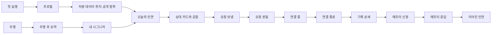

# 경험 명세

화면, 동작, 상태의 기준입니다. 시각 기준은 `docs/design/screens/Red*.dc.html`이고, 값은 그 파일의 인라인 스타일에서 그대로 가져옵니다. 이 문서는 시안과 달라지는 점과 시안에 없는 화면을 정의합니다.

## 시안에서 바꾸는 점

| 항목 | 시안 | 구현 | 이유 |
|---|---|---|---|
| 상단 줄 | 시각, 기어, 5G, 합성 위치 | **시각과 5G 제거.** 기어 상태(`P 주차 중`, `D 주행 중`)를 표시해요. 주차 화면의 `시연 제어`는 작은 아이콘 버튼이며, `합성 위치`는 서버 모드에서만 표시해요 | 시각과 통신 상태는 차량 시스템 UI가 보여줍니다 |
| 기준 크기 | 1600×1280 | **1682×1210dp**에 맞춤 | Pleos 앱 창 실측값. 160dpi라 1dp = 1px입니다 |
| 세로 여유 | 넉넉함 | 패널 높이를 줄여 넘치지 않게 조정 | 창이 70dp 낮습니다 |
| 좁은 창 | 연결 중만 840폭 | 폭 1100dp 미만이면 모든 화면이 한 열로 쌓이고 스크롤 | 화면 분할 대응 |
| 참여 준비 하단 | 프로필·공개 범위의 `이전` 버튼 | 세 단계와 프로필 편집 모두 기본 버튼 하나를 콘텐츠 전체 너비로 표시해요. 단계 전환·스크롤에도 위치를 유지해요. 뒤로가기는 상단 원형 버튼과 시스템 뒤로가기를 사용하며 기존 주행 잠금 규칙을 유지해요 | 중복 뒤로가기와 첫 단계의 빈 슬롯 제거 |
| 프로필 | 닉네임, 아바타, 관심사 | 시그니처가 먼저, 관심사는 그다음 | 차량 특화 핵심 |
| 인연 이동 | 기록·애프터가 별도 이동 | 하단 `홈 · 인연 · 내 프로필`, 인연은 한 사람당 한 행인 통합 목록 | 관계를 한곳에서 확인 |
| 애프터 | 메시지 대화 | 상호 수락한 연락처 ID 교환 | 차 밖에서 이어갈 수단을 직접 선택 |
| 내 정보 | 프로필과 설정 | `내 프로필`로 바꾸고 매듭과 칭호를 앞세움 | 같음 |

## 전체 흐름

## 화면 목록

### 시안이 있는 화면

| 화면 | 모듈 | 시안 | 추가 사항 |
|---|---|---|---|
| 첫 실행 | `feature:history` | `RedFirstRun` | `혼자 둘러보기(가상 상대)`와 `두 대로 연결(서버)` 모드만 선택. 서버 주소가 없으면 이 화면 없이 SOLO 프로필 만들기로 진입 |
| 프로필 등록·편집 | `feature:history` | `RedProfileSetup` | 저장 실패와 재시도 |
| 차량 데이터·위치·공개 범위 | `feature:history` | `RedConsent` | 차량 데이터 동의와 선택 마이크 권한 행 추가 |
| 오늘의 인연 | `feature:meet` | `RedHome` | 카드에 칭호, 공개 점수 상위 3개 칩, 잘 맞는 점 수 |
| 상대 카드 | `feature:meet` | `RedCandidate` | 매듭, 공개 점수 상위 3개, 특성, 궁합 |
| 요청 보냄, 요청 받음 | `feature:meet` | `RedRequestSent`, `RedRequestIncoming` | 칭호, 공개 점수 상위 3개와 잘 맞는 점. 응답 기한 실제 카운트다운. `수락하면 바로 통화가 연결돼요` |
| 연결 중 | `feature:meet` | `RedConnected` | 두 아바타와 통화 상태, 음소거·통화 끊기가 중심. 주차 중 `상대의 운전` 상위 3개 칩과 읽기 전용 이야깃거리 |
| 연결 중, 주행 제한 | `feature:meet` | `RedConnectedDriving` | 차분한 통화 화면, 상대 닉네임·아바타·칭호, 정적 점수 최대 2개와 96dp 이상 음소거·통화 끊기 |
| 연결 중, 좁은 창 | `feature:meet` | `RedConnectedNarrow` | 폭 1100dp 미만 |
| 연결 종료 | `feature:meet` | `RedEnded` | 기존 종료 사유를 통화가 끝난 문장으로 표시 |
| 스친 인연, 기록 상세 | `feature:history` | `RedEncounters`, `RedEncounterDetail` | 상세에 궁합 |
| 애프터 신청, 응답 | `feature:history` | `RedAfterRequest`, `RedAfterIncoming` | |
| 이어진 인연 | `feature:history` | `RedAfterConnected` | 관계 끝내기 확인 |
| 내 프로필 | `feature:signature` | `RedSettings` 기반 | 왼쪽 패널에 아바타, 매듭, 칭호. `주행 중 연결` 3단계와 자동 연결 조건(기본 끄기) |
| 차단·신고, 기록·계정 정리 | `feature:history` | `RedBlockReport`, `RedCleanup` | |
| 상태 화면 17종 | 각 기능 | `RedStatesDiscover`, `RedStatesConnect` | 모두 실제 상태로 도달 가능해야 함 |

### 시안이 없는 새 화면

같은 디자인 언어로 만듭니다.

| 화면 | 모듈 | 내용 |
|---|---|---|
| 내 시그니처 | `feature:signature` | 왼쪽 큰 매듭과 칭호, 오른쪽 주행 스타일과 차량 관리 특성 카드. `공개 범위`, 근거 보기 |
| 특성 상세 | `feature:signature` | 내 점수 /100, 단계 사다리, 지원·통과 횟수, 기간·포함 주행 수, 최근 12회 막대 차트·최근 주행 표, 공개 토글. 본인에게만 표시 |
| 공개 범위 | `feature:signature` | 특성별 토글. 오른쪽에 `상대에게 이렇게 보여요` 실시간 미리보기 |
| 주행 후 요약 | `feature:signature` | 주차 직후 전체 화면. 매듭이 새 가닥으로 다시 그려지는 연출, 이번 주행의 변화 문장, 차량 주행에만 `내가 운전하지 않았어요`, `내 시그니처 보기` |
| 주행 중 | `feature:meet` | 발견 화면에서 D로 바뀌면 전환. 차분한 어두운 화면에 `주행 중이에요`, `주차하면 다시 볼 수 있어요`. 수치 표시 없음 |
| 시그니처 만들기 | `app` | 홈 초대와 기록 중 안내에서 진입. 질문, 설명이 있는 세 선택 카드와 3회 진행 상황을 보여줘요. SOLO에서는 출처 문구를 반복하지 않고, 서버 모드에서는 `합성 주행` 표시를 유지해요. 차량 관리 선택이 첫 번째이고 완성 후 첫 시그니처로 이어져요 |
| 시연 제어 | `app` | 상단의 작은 아이콘 버튼으로 열어요. 터치 영역은 76dp 이상이며 접근성 설명은 `시연 제어`예요. ALLOWED일 때만 표시해요. 합성 주행 추가와 이탈·복귀를 제어하고, 실제 차량 서비스가 없을 때만 기어 제어를 보여줘요. 연결 중에도 같은 버튼을 쓰고 뒤로 가면 연결로 돌아와요 |

## 움직임

한 번의 연출을 제대로 합니다. 흩어진 효과를 넣지 않습니다.

| 순간 | 연출 | 길이 |
|---|---|---|
| 연결 성립 | 실이 A에서 B로 뻗어 이어지고 빛이 한 번 흐름 | 700ms |
| 연결 중 | 실 위로 빛 점이 느리게 흐름 | 반복 |
| 연결 종료 | 실이 가운데에서 끊어져 물러남 | 450ms |
| 애프터 성립 | 구슬이 모여 매듭으로 묶임 | 900ms |
| 주행 후 요약 | 매듭에 새 가닥이 그려짐 | 1200ms |
| 버튼 누름 | 젤리처럼 살짝 눌림 | 120ms |

- 주행 중이거나 상태를 모르면 장식 움직임을 모두 멈춥니다.
- 시스템 애니메이션 배율이 0이면 끝 상태만 보여줍니다.

## 주행 정책

| 상태 | 조건 | 동작 |
|---|---|---|
| `ALLOWED` | 신선한 기어 P, UX 제한 없음 | 전체 조작. 마이크 권한은 선택 |
| `RESTRICTED` | D, N, R 또는 UX 제한 | 기존 통화 유지, 음소거/음소거 해제와 통화 끊기. RING/AUTO 수신 화면의 받기/거절과 사전 AUTO 동의·조건에 맞는 자동 요청·수락 허용. 탐색·수동 발신·일반 수락·입력·편집은 금지 |
| `UNKNOWN` | 신호 없음, 오류 | 새 조작과 권한 창을 막고 통화 끊기만 허용. 진행 중 음성은 연결 수명에 따름 |

- 속도 0을 주차로 판단하지 않습니다.
- 기본 OFF에서는 제한 중 도착한 연결·애프터 요청을 내용 없는 알림으로 알리고 주차 후 보여줘요. RING 또는 조건에 맞지 않는 AUTO의 RESTRICTED에서는 닉네임·아바타·칭호와 정적 점수 최대 2개인 전화형 요청 화면을 열어요. 통화 알림은 CATEGORY_CALL이고 통화 끊기 action이 있어요.
- Activity는 하나이며 `distractionOptimized`를 선언합니다.

## 문구

- 해요체. 쉬운 말. 사용자가 무엇을 할 수 있는지 먼저 말합니다.
- 오류는 무엇이 일어났고 무엇을 하면 되는지 말합니다. 사과하지 않습니다.
- 이모지를 쓰지 않습니다.
- "최초", "안전 보장", "검증된" 같은 근거 없는 주장을 쓰지 않습니다.
- 빠른 운전을 칭찬하는 표현을 쓰지 않습니다.
- `혼자 둘러보기`(SOLO)는 서버 주소가 없으면 첫 프로필 만들기에서, 서버 주소가 있으면 모드 선택에서 가상 상대임을 안내하고, 내 시그니처 근거에 데이터 출처를 한 줄로 보여줘요. 나머지 화면에서는 출처 문구를 반복하지 않아요. 서버 모드는 실제 사람과 섞이는 가상 상대와 합성 데이터에 작은 표시를 유지해요.
- 홈 제목은 모든 모드에서 `근처에서 n명이 발견을 켰어요`예요. 표시 여부는 앱이 활성 세션 모드로 정해 기능 화면에 전달해요.

## 접근성

- 터치 대상은 최소 76dp입니다. 차량 화면 기준입니다.
- 모든 아이콘 버튼과 의미 있는 이미지에 설명을 답니다. 장식 이미지는 숨깁니다.
- 본문 대비 4.5:1 이상. 색만으로 상태를 구분하지 않습니다.
- 글자 최소 20sp입니다.
- 토글과 라디오는 역할과 상태를 스크린 리더에 전달합니다.

## 품질 기준

이 앱은 세계 최고 수준의 소비자 앱을 기준으로 평가합니다. 완성 판단은 [품질 기준](quality-bar.md)을 따릅니다.

## 시그니처와 인연의 표시 규칙

- 첫 시그니처는 최대 세 특성을 보여 주며, 얻은 차량 관리 특성을 하나 이상 포함해요. 합성 주행의 제목은 `이 주행이 매듭이 됐어요`, 차량 주행은 `내 주행이 매듭이 됐어요`예요.
- 내 프로필과 근거의 미지원 특성은 `이 차량에서 제공되지 않아요`로 표시해요. 데이터 출처는 내 근거의 한 줄과 서버 모드의 작은 표시로 구분해요. 공개할 수 없는 토글은 꺼진 모습으로 잠그되 이전 선택은 보존해요.
- 홈의 초대 카드가 있어도 발견 토글은 히어로 왼쪽 설명 아래에 놓고 하트 오브와 겹치지 않아요. 첫 후보 줄에는 차량 관리 칭호가 있어요.
- 이어진 인연은 간결한 관계 목록에서 상대를 고르고, 오른쪽에서 서로 공유한 카카오톡·인스타그램 ID를 확인해요. 같은 상대의 큰 카드를 반복하지 않아요. 상대 출처는 서버 모드에서만 작게 표시해요.
- 요청 배너는 해당 요청을 열면 지워져요. 다른 화면의 배너도 주차 상태로 5초 표시한 뒤 사라져요. 연락처 ID는 알림에 넣지 않아요.

## 집 보호 구역

- 내 프로필의 `차량 데이터와 위치 사용` 옆 행과 동의 화면의 선택 항목에서 열어요. 설정은 선택이며 가입 조건이 아니에요.
- `집 근처에서는 나를 찾을 수 없어요`, `이어져 있던 사람에게는 멀어져서 끝난 것과 똑같이 보여요`, `집 위치는 이 차에만 저장되고 서버로 보내지 않아요`를 안내해요.
- 주차 상태에서 현재 위치를 집으로 정하며 정밀 위치 권한을 요청해요. 지도와 좌표는 없어요. 반경은 300m·500m·1km이고 기본은 500m예요. 저장 전 중심을 반경의 최대 25%만큼 무작위로 옮겨요. 반경 변경은 저장된 중심을 유지해요.
- 반경 안에 들어오면 바로 발견을 쉬어요. 반경보다 50m 더 먼 곳에서 30~90초 연속 확인한 뒤 돌아와요. 위치가 없거나 오래됐거나 권한이 꺼졌을 때도 발견을 쉬며, 권한·위치 서비스를 확인하도록 안내해요. 프로세스를 다시 열어도 밖임이 확인되기 전에는 쉬어요.
- 발견을 켜 둔 홈에는 `집 근처에서는 쉬고 있어요`, `벗어나면 다시 찾을 수 있어요`가 보여요. 하단 오브는 `쉬는 중`이고 후보는 감춰요. 하단을 숨기는 주행 제한 화면에서는 상단에 `쉬는 중`만 표시하고 집 설명과 조작을 숨겨요. 직접 꺼 둔 발견은 구역 밖에서도 켜지지 않아요. 종료 사유는 그대로 두고 통화가 끝난 문장으로 안내해요.
- 실제 위치가 없으면 시연 빌드에서 집 보호를 살펴볼 수 있어요. SOLO의 버튼은 `집 보호 시작하기`이며 출처 칩은 없어요. 서버 모드는 `합성 위치로 집 정하기`와 `합성 위치 · 가상 집` 표시를 유지해요. 시연 제어의 `집 근처로 오기`·`집에서 멀어지기`로 조작하며, 멀어지기는 가상 상대가 있는 곳으로 돌아가는 동작도 포함해요. 이 경로의 복귀 지연은 2초예요.
- 새 화면은 RedConsent와 RedSettings의 글래스 카드, 잠금 오브, 젤리 버튼, 공통 토큰을 써요. 1100dp 미만은 한 열이며 주행 제한·상태 불명에서는 설정 내용과 조작을 숨겨요. 집 지우기는 확인창을 거쳐요. 로그아웃·계정 삭제는 집 기록도 지워요.
- 주행 중 집 보호가 시작되면 주차 중 이미 본 연결도 상대 정보 없이 가려요. 다시 주차하기 전에는 상대 정보를 다시 펼치지 않아요. 서버의 종료 사유는 유지하고 같은 통화 종료 화면을 사용해요.
- 보호 중 요청 화면은 `집 근처에서 쉬는 동안에는 수락할 수 없어요`라고 안내하고 수락을 막아요. 거절은 할 수 있어요. 주행 제한 안내와 구분해요.
- 세션을 다시 열 때 집 기록은 먼저 읽지만 서버 응답을 기다리며 첫 화면에 묶어 두지 않아요. 오프라인에서도 홈·내 프로필·집 보호 구역에 접근할 수 있어요. 후보·요청·수락은 로컬에서 즉시 보호하고 발견을 켜기 전에는 presence 적용을 확인해요.
- 서버 세션은 20초마다 연결 생존을 알리고 서버는 마지막 갱신부터 60초 뒤 presence를 만료시켜요. 상대는 집 보호·앱 종료·차량 전원 종료·통신 단절에서 같은 거리 이탈을 봐요. 앱이 죽은 뒤 발견 가능 상태가 최대 60초 남을 수 있고 연결 종료에는 기존 유예 시간이 더해져요.
- 집 좌표와 반경은 서버로 보내지 않아요. 서버 운영자는 명시적 AWAY가 도착했다는 사실을 볼 수 있고, 이번 빌드에는 실제 위치 기반 이탈이 없으므로 집 보호 때문이라고 추측할 수 있어요. 상대에게 보이는 동작의 동일성이 운영자에 대한 원인 비공개를 보장하지는 않아요.
- 위치 사용 동의가 확인되기 전에는 GPS를 읽지 않고 `LOCATION_UNKNOWN`으로 보호해요. 동의를 끄면 GPS 구독을 멈추고 `PERMISSION_OFF`로 보호해요. 이 상태는 런타임 권한이 꺼진 경우도 포함하므로 `위치 사용이 꺼져 있어 쉬고 있어요`와 함께 위치 권한·위치 사용 동의를 확인하도록 안내해요.
- 실제 위치로 집 정하기는 저장된 위치 사용 동의가 있을 때만 켜져요. 동의가 없으면 `위치 사용에 동의하면 집을 정할 수 있어요`, 미확인이면 `위치 사용 동의를 확인하고 있어요`라고 안내해요. 합성 집 설정은 동의 없이도 사용할 수 있으며 출처 표시는 세션 모드 규칙을 따라요.
- 동의 화면의 선택은 즉시 저장해요. 저장 중에는 `집 보호 구역 · 선택`을 잠그고, 들어간 화면에서도 저장된 동의를 다시 확인해요. 위치 동의 철회로 presence가 거절되면 자동 전송을 멈추며, 다시 발견을 켤 때 적용을 확인한 뒤 재개해요.

## 연결은 통화예요

- 연결 수락으로 CONNECTED가 되면 양측 통화에 자동 참여해요. 요청 보냄/받음 화면에 `수락하면 바로 통화가 연결돼요`를 안내해요.
- 주차 중에는 두 아바타, `통화 중`, `음소거`와 `통화 끊기`를 중심으로 보여줘요. `이야깃거리`에는 실제로 공개된 공통 관심사·궁합 문장·각자의 칭호만 보여줘요. 정보가 없으면 빈 카드나 임의 문구를 만들지 않아요. 임시 연결에는 메시지 스레드와 인사 전송 버튼이 없어요. 1100dp 미만에서는 한 열로 배치해요.
- 주행 중에는 상대 아바타·닉네임·칭호와 통화 상태, 공개 점수 상위 최대 2개를 큰 정적 칩으로 보여줘요. 좁은 창에서도 점수와 버튼이 보이도록 주행 통화는 상대 아바타를 중심으로 표시해요. 이야깃거리, 그 밖의 숫자, 장식 움직임은 숨겨요. 버튼은 각각 96dp 이상이고 음소거하면 `음소거 중`과 `음소거 해제`로 바뀌어요. 상태 변경은 live region으로 전달해요.
- `주행 중 연결`은 `끄기`(기본) / `전화처럼 받기` / `조건에 맞으면 자동 연결`이에요. 이전 boolean true는 `전화처럼 받기`로 옮겨요. RING/AUTO의 RESTRICTED 전화형 수신 화면은 받기/거절을 허용하고 칭호·공개 점수 최대 2개를 보여줘요. 관심사·궁합·기한 숫자·탐색은 표시하지 않아요. 집 보호 중에는 `집 근처에서 쉬는 동안에는 수락할 수 없어요`를 보여주고 받기를 막아요.
- 온보딩에 `마이크 · 선택`과 설명 `연결된 상대와 통화할 때만 써요`를 독립 행으로 제공해요. 거부해도 완료할 수 있어요. 통화 화면에서 주차 중 다시 허용할 수 있고 RESTRICTED/UNKNOWN에서는 권한 창을 띄우지 않아요. 마이크 권한·기기 개인정보 스위치·입력 장치 문제는 `이 차에서는 마이크를 쓸 수 없어요`라는 차분한 상태로 안내하고 수신은 유지해요.
- 일시 연결이 끝나면 통화도 끝나요. 확인 중에는 음성을 멈추고 CONNECTED 복귀 때 다시 참여해요. 집 보호로 화면을 가리면 마이크와 재생도 즉시 멈춰요. 거리 종료는 `서로 멀어져서 통화가 끝났어요`로 안내해요. 애프터는 연락처 교환으로 이어져요.
- 데모 상대는 SOLO와 SERVER_DEMO 모두 같은 통화 화면을 사용하고, 마이크와 음성 WebSocket을 열지 않아요. Pleos 기기 내 음성으로 상대별 준비된 세 문장을 한 번씩 재생해요. 초기 준비를 먼저 요청하고, 각 문장의 시작 시각을 기준으로 약 20초 뒤 다음 문장을 재생해요. 오디오 포커스가 있을 때만 재생하며 포커스 상실·집 보호·연결 종료에는 즉시 멈춰요. SDK의 시작 콜백이 실제 소리 시작을 보장하지 않아 `상대가 말하는 중` 표시나 발화 애니메이션을 만들지 않아요. 출처 문구는 기존 SOLO/SERVER_DEMO 규칙을 유지해요.

## 인연과 연락처 교환

- 하단은 `홈 · 인연 · 내 프로필`이에요. `인연`에는 내부 탭 없이 한 사람당 한 행인 통합 목록을 보여줘요. 받은 애프터는 맨 위의 빨간 배지로, 이어진 관계는 하트로, 보낸 신청은 `답을 기다려요`로, 스친 관계는 기본 행으로 구분해요. 같은 사람이 여러 상태에 있어도 행을 반복하지 않아요. 행을 누르면 현재 상태에 맞는 기록·신청·연락처 상세를 열어요. 기존 기록·애프터 진입도 이 목록과 상세로 연결해요.
- 프로필 편집의 카카오톡·인스타그램 ID는 선택 항목이며 둘 다 비워도 가입·저장이 가능해요. 사진과 차량 정보는 포함하지 않아요. 저장한 ID는 본인에게만 보이고 공개 프로필·후보·요청·기록에는 실리지 않아요.
- 신청·수락할 때 이번에 공유할 ID를 직접 골라요. 저장된 ID의 선택과 새 ID 입력을 지원하며, 유효한 ID 하나 이상이 필요해요. 없거나 형식이 맞지 않으면 입력 옆에서 안내하고 제출하지 않아요. `프로필에 저장`은 별도 선택이며 공유할 항목을 자동으로 늘리지 않아요.
- 수신 화면은 `수락하면 내가 고른 아이디도 상대에게 보여요`를 분명히 안내해요. 신청·수락 화면에는 `한 번 공유한 아이디는 되돌릴 수 없어요.`를 표시해요. 양측 수락 전에는 상대 ID가 보이지 않아요. 거절·철회·만료에는 교환하지 않아요.
- 입력은 양끝 공백을 없애고 소문자로 정리해요. 인스타그램은 앞의 `@` 하나를 없애요. 카카오톡은 영문 소문자·숫자·밑줄·마침표·하이픈 4~20자, 인스타그램은 영문 소문자·숫자·밑줄·마침표 1~30자예요. 인스타그램의 앞뒤 마침표와 연속 마침표는 허용하지 않아요. 이메일·전화번호·전체 URL은 ID 입력이 아니에요. 서버도 같은 규칙을 검사해요.
- 인스타그램은 `https://instagram.com/<id>` QR을 기기 안에서 만들어요. 카카오톡은 공개 프로필 URL을 추정하지 않고 큰 ID 텍스트만 표시해요. QR·ID 확인과 모든 교환 조작은 ALLOWED에서만 가능해요. RESTRICTED·UNKNOWN으로 바뀌면 이미 열었던 ID와 QR도 바로 숨겨요.
- 관계 종료·차단·계정 삭제 뒤에는 앱과 API의 교환 ID를 지우고 과거 명령 재시도로 되살리지 않아요. 상대가 이미 외부에 보관한 ID까지 회수할 수 있다는 뜻은 아니에요. 계정 삭제는 저장 ID와 교환 ID의 모든 사본을 제거해요.
- 가상 상대의 연락처는 실제 계정이 아닌 시연용 값이에요. 인스타그램 형식상 만들 수 없는 하이픈을 넣은 `byeol-night.drive` 같은 예약 값을 엔진이 직접 제공하며 사용자 입력 검증의 예외로 넓히지 않아요. 카카오톡 ID를 임의 생성하지 않아요. SOLO에서는 출처 문구를 반복하지 않고 서버 모드에서는 작은 시연 표시를 유지해요.

## 운전 점수가 프로필이에요

이번 변경은 MyProfile·TraitDetail·ProfileBuilding·DriveSettings·Main·Request·CallParked·CallDriving·IncomingDriving의 승인된 구조를 현재 컴포넌트와 토큰으로 구현해요. 별도의 시각 개편과 이미지 교체는 포함하지 않아요.

- 후보 홈·상세, 받은/보낸 요청은 공개된 점수 특성을 점수 내림차순으로 최대 3개 보여줘요. 동점은 특성의 고정 순서로 정해 입력 순서에 흔들리지 않아요. 칩 문구는 `깜빡이 매너 88`처럼 이름과 점수예요. 그 뒤 기존 궁합을 보여줘요.
- 주차한 요청은 상대 헤더·칭호·점수·궁합을 한 카드로 모아 좁은 창에서도 점수가 가려지지 않게 해요.
- 주차한 통화에는 `이야깃거리` 위에 `상대의 운전`과 공개 점수 최대 3개를 둬요. 주행 통화와 주행 수신 화면에는 칭호와 큰 정적 칩 최대 2개만 추가하고 다른 숫자는 숨겨요.
- 내 프로필은 모든 특성의 점수 막대와 숫자, 공개/숨김 상태를 보여줘요. 60점 미만은 `나만 보여요`, 취향은 점수 없는 배지, 미지원은 `이 차량에서 제공되지 않아요`예요. 점수 행을 누르면 해당 특성 근거로 이동해요.
- 근거에는 큰 점수 `/100`, `60 보여요 · 75 꾸준해요 · 90 시그니처` 사다리와 내 위치·다음 단계까지 남은 점수, 특성에 맞는 지원/통과 횟수 타일, 포함 주행 수와 최근 30일 기간이 있어요. 예를 들면 `방향 전환 50번` / `깜빡이를 켬 44번`이에요.
- 최근 포함 주행 최대 12회의 비율 차트는 단일 계열·한 색으로 그려요. 범례는 없고 그리드는 약하게, 60은 점선으로 표시해요. 막대는 기준선에 붙고 윗부분만 둥글며 누르면 그 주행을 보여줘요. 최근 주행 표는 시각·시간·지원/통과 횟수·포함 또는 `내가 운전 안 함`을 담아요. 특성 공개 토글도 이 화면에 있어요. 다른 사람에게 이 기록과 횟수는 전하지 않아요.
- 3회 미만의 만들기 상태는 `주행 기록 켜짐`, 세 구간의 `n / 3 주행`, `지난 주행에서 모은 것`과 최근 주행별 횟수를 보여줘요. `방향 전환 6번 중 5번 켰어요`처럼 근거만 설명해요. 미지원 특성, 3분·2km 기준, 다른 사람이 운전한 주행 제외 규칙을 안내하고 아직 점수는 보여주지 않아요.
- 내 프로필·근거·만들기·연결 설정은 ALLOWED에서만 볼 수 있고 편집할 수 있어요. 제한·상태 불명에서는 기존 주행 제한 화면을 사용해요.

## 주행 중 자동 연결

자동 연결은 사용자가 주차 중 미리 고른 조건과 동의로 기존 연결 요청·수락을 실행하는 클라이언트 기능이에요. 서버가 상대를 찾거나 클라이언트의 동의 주장을 신뢰하지 않아요. 서버는 인증·참여 동의·차단·근접·요청 유효성·활성 연결 한 개 규칙을 그대로 검사해요.

- 조건은 점수 특성마다 선택하는 최소 점수 60~100(5점 단위)와 선택 항목 `관심사가 하나 이상 겹치는 사람`이에요. 상대가 공개하지 않은 특성은 실패예요. 지정한 조건은 모두 만족해야 해요. 설정과 조건의 저장은 ALLOWED에서만 가능해요.
- 발신은 AUTO + 발견 ON + RESTRICTED + 활성 연결 없음 + 보낸 대기 요청 없음 + 집 보호 아님일 때만 가능해요. 조건을 통과한 후보 중 최소 점수를 초과한 조건 개수, 공통 관심사 개수, 고정 ID 순으로 한 명을 골라 자동 표시된 일반 요청을 보내요. 자동 대기 요청은 최대 한 개예요.
- RESTRICTED에서 받은 요청이 AUTO 조건에 맞으면 사전 동의에 따라 자동 수락해요. AUTO 조건에 맞지 않으면 전화처럼 받기 화면을 열어요. RING은 전화형 수신 화면, OFF는 주차할 때까지 기다려요. 주차 중에는 모드와 관계없이 모두 수동이에요.
- 통화가 자동으로 이어지면 Pleos 기기 내 음성으로 `별보는밤님과 연결됐어요`처럼 닉네임과 연결 사실만 한 번 알리고 주행 통화 화면을 열어요. 같은 연결의 재관찰·재접속으로 반복 발화하지 않아요.
- 통화 종료 뒤 10분 동안 자동 발신·수락을 쉬어요. 거절·취소·종료·만료된 상대에게 같은 달력 날짜에 자동 요청·수락을 다시 하지 않아요. 차단한 사람과 집 보호 중에는 자동 동작이 없고 요청 만료·활성 연결 한 개 규칙을 유지해요. UNKNOWN에서는 자동 동작도 하지 않아요.
- SOLO와 서버 시연 상대의 기존 응답 규칙은 유지해요. AUTO와 조건을 고르고 발견을 켠 뒤 시연 콘솔로 D에 들어가면 조건에 맞는 가상 상대가 기존 규칙대로 수락하고 연결 안내와 통화 화면이 나와요.

## 첫 실행과 설치별 프로필

서버 주소가 있으면 모드만 고른 뒤 `시작하기`로 들어가요. 계정·공간 선택은 없어요. 서버 주소가 없으면 SOLO 프로필 만들기로 바로 들어가며 이곳에서 가상 상대임을 알려요. 닉네임은 비어 있고 `실명 대신 부를 이름`을 안내하며 기본 아바타는 DAWN이에요. 로그아웃은 빈 첫 실행으로 돌아가요. 서버의 기존 프로필은 계정 삭제 전까지 운영 저장 정책에 따라 남을 수 있어요.
