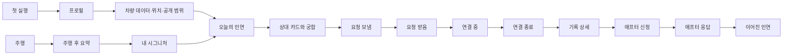

# 경험 명세

화면, 동작, 상태의 기준입니다. 시각 기준은 `docs/design/screens/Red*.dc.html`이고, 값은 그 파일의 인라인 스타일에서 그대로 가져옵니다. 이 문서는 시안과 달라지는 점과 시안에 없는 화면을 정의합니다.

## 시안에서 바꾸는 점

| 항목 | 시안 | 구현 | 이유 |
|---|---|---|---|
| 상단 줄 | 시각, 기어, 5G, 합성 위치 | **시각과 5G 제거.** 기어 상태(`P 주차 중`, `D 주행 중`)와 `합성 위치`를 표시하고, 시연 빌드의 주차 화면에는 옆에 작은 `시연 제어` 칩을 표시 | 시각과 통신 상태는 차량 시스템 UI가 보여줍니다 |
| 기준 크기 | 1600×1280 | **1682×1210dp**에 맞춤 | Pleos 앱 창 실측값. 160dpi라 1dp = 1px입니다 |
| 세로 여유 | 넉넉함 | 패널 높이를 줄여 넘치지 않게 조정 | 창이 70dp 낮습니다 |
| 좁은 창 | 연결 중만 840폭 | 폭 1100dp 미만이면 모든 화면이 한 열로 쌓이고 스크롤 | 화면 분할 대응 |
| 프로필 | 닉네임, 아바타, 관심사 | 시그니처가 먼저, 관심사는 그다음 | 차량 특화 핵심 |
| 내 정보 | 프로필과 설정 | `내 프로필`로 바꾸고 매듭과 칭호를 앞세움 | 같음 |

## 전체 흐름

## 화면 목록

### 시안이 있는 화면

| 화면 | 모듈 | 시안 | 추가 사항 |
|---|---|---|---|
| 첫 실행 | `feature:history` | `RedFirstRun` | `혼자 둘러보기(가상 상대)`와 `두 대로 연결(서버)` 선택 추가. 서버 주소가 없으면 두 번째를 숨김 |
| 프로필 등록·편집 | `feature:history` | `RedProfileSetup` | 저장 실패와 재시도 |
| 차량 데이터·위치·공개 범위 | `feature:history` | `RedConsent` | 차량 데이터 동의 섹션 추가 |
| 오늘의 인연 | `feature:meet` | `RedHome` | 카드에 칭호, 대표 특성, 잘 맞는 점 수 |
| 상대 카드 | `feature:meet` | `RedCandidate` | 매듭, 특성, 궁합 |
| 요청 보냄, 요청 받음 | `feature:meet` | `RedRequestSent`, `RedRequestIncoming` | 칭호와 잘 맞는 점. 응답 기한 실제 카운트다운 |
| 연결 중 | `feature:meet` | `RedConnected` | 시그니처 기반 프리셋 |
| 연결 중, 주행 제한 | `feature:meet` | `RedConnectedDriving` | 넓은 창의 주행 잠금 |
| 연결 중, 좁은 창 | `feature:meet` | `RedConnectedNarrow` | 폭 1100dp 미만 |
| 연결 종료 | `feature:meet` | `RedEnded` | 종료 사유 5종 |
| 스친 인연, 기록 상세 | `feature:history` | `RedEncounters`, `RedEncounterDetail` | 상세에 궁합 |
| 애프터 신청, 응답 | `feature:history` | `RedAfterRequest`, `RedAfterIncoming` | |
| 이어진 인연 | `feature:history` | `RedAfterConnected` | 관계 끝내기 확인 |
| 내 프로필 | `feature:signature` | `RedSettings` 기반 | 왼쪽 패널에 아바타, 매듭, 칭호 |
| 차단·신고, 기록·계정 정리 | `feature:history` | `RedBlockReport`, `RedCleanup` | |
| 상태 화면 18종 | 각 기능 | `RedStatesDiscover`, `RedStatesConnect` | 모두 실제 상태로 도달 가능해야 함 |

### 시안이 없는 새 화면

같은 디자인 언어로 만듭니다.

| 화면 | 모듈 | 내용 |
|---|---|---|
| 내 시그니처 | `feature:signature` | 왼쪽 큰 매듭과 칭호, 오른쪽 주행 스타일과 차량 관리 특성 카드. `공개 범위`, 근거 보기 |
| 특성 상세 | `feature:signature` | 왜 이 단계인지, 읽은 신호, 집계 기간, 내 지표(본인에게만), 최근 변화. 평가하지 않는 말투 |
| 공개 범위 | `feature:signature` | 특성별 토글. 오른쪽에 `상대에게 이렇게 보여요` 실시간 미리보기 |
| 주행 후 요약 | `feature:signature` | 주차 직후 전체 화면. 매듭이 새 가닥으로 다시 그려지는 연출, 이번 주행의 변화 문장, 차량 주행에만 `내가 운전하지 않았어요`, `내 시그니처 보기` |
| 주행 중 | `feature:meet` | 발견 화면에서 D로 바뀌면 전환. 차분한 어두운 화면에 `주행 중이에요`, `주차하면 다시 볼 수 있어요`. 수치 표시 없음 |
| 시그니처 만들기 | `app` | 홈 초대와 기록 중 안내에서 진입. 질문, 설명이 있는 세 선택 카드, `합성 주행` 표시, 3회 진행 상황만 보여줘요. 차량 관리 선택이 첫 번째이고 완성 후 첫 시그니처로 이어져요 |
| 시연 제어 | `app` | 상단 `합성 위치` 옆의 76dp 이상 터치 칩에서 열어요. ALLOWED일 때만 표시해요. 합성 주행 추가와 이탈·복귀를 제어하고, 실제 차량 서비스가 없을 때만 기어 제어를 보여줘요. 연결 중에도 같은 칩을 쓰고 뒤로 가면 연결로 돌아와요 |

## 움직임

한 번의 연출을 제대로 합니다. 흩어진 효과를 넣지 않습니다.

| 순간 | 연출 | 길이 |
|---|---|---|
| 연결 성립 | 실이 A에서 B로 뻗어 이어지고 빛이 한 번 흐름 | 700ms |
| 연결 중 | 실 위로 빛 점이 느리게 흐름 | 반복 |
| 연결 종료 | 실이 가운데에서 끊어져 물러남 | 450ms |
| 애프터 성립 | 구슬이 모여 매듭으로 묶임 | 900ms |
| 주행 후 요약 | 매듭에 새 가닥이 그려짐 | 1200ms |
| 버튼 누름 | 젤리처럼 살짝 눌림 | 120ms |

- 주행 중이거나 상태를 모르면 장식 움직임을 모두 멈춥니다.
- 시스템 애니메이션 배율이 0이면 끝 상태만 보여줍니다.

## 주행 정책

| 상태 | 조건 | 동작 |
|---|---|---|
| `ALLOWED` | 기어 P, 주행 상태 0 | 전체 조작 |
| `RESTRICTED` | D, N, R 또는 주행 상태 1 이상 | 탐색, 요청, 수락, 입력, 프로필 편집 금지. `나가기`만 허용 |
| `UNKNOWN` | 신호 없음, 오류 | `RESTRICTED`와 동일 |

- 속도 0을 주차로 판단하지 않습니다.
- 제한 중 도착한 요청과 인사는 `CATEGORY_MESSAGE` 알림으로 짧게 알리고 내용은 주차 후 보여줍니다.
- Activity는 하나이며 `distractionOptimized`를 선언합니다.

## 문구

- 해요체. 쉬운 말. 사용자가 무엇을 할 수 있는지 먼저 말합니다.
- 오류는 무엇이 일어났고 무엇을 하면 되는지 말합니다. 사과하지 않습니다.
- 이모지를 쓰지 않습니다.
- "최초", "안전 보장", "검증된" 같은 근거 없는 주장을 쓰지 않습니다.
- 빠른 운전을 칭찬하는 표현을 쓰지 않습니다.
- 가상 데이터는 항상 `가상 프로필`, `합성 위치`, `합성 주행`, `시연용 가상 상대`로 표시합니다.

## 접근성

- 터치 대상은 최소 76dp입니다. 차량 화면 기준입니다.
- 모든 아이콘 버튼과 의미 있는 이미지에 설명을 답니다. 장식 이미지는 숨깁니다.
- 본문 대비 4.5:1 이상. 색만으로 상태를 구분하지 않습니다.
- 글자 최소 20sp입니다.
- 토글과 라디오는 역할과 상태를 스크린 리더에 전달합니다.

## 품질 기준

이 앱은 세계 최고 수준의 소비자 앱을 기준으로 평가합니다. 완성 판단은 [품질 기준](quality-bar.md)을 따릅니다.

## 시그니처와 대화의 표시 규칙

- 첫 시그니처는 최대 세 특성을 보여 주며, 얻은 차량 관리 특성을 하나 이상 포함해요. 합성 주행의 제목은 `이 주행이 매듭이 됐어요`, 차량 주행은 `내 주행이 매듭이 됐어요`예요.
- 미지원 특성은 합성 출처일 때 `이번 합성 주행에는 없는 특성이에요`, 차량 출처일 때 `이 차량에서 제공되지 않아요`로 표시해요. 공개할 수 없는 토글은 꺼진 모습으로 잠그되 이전 선택은 보존해요.
- 홈의 초대 카드가 있어도 발견 토글은 히어로 왼쪽 설명 아래에 놓고 하트 오브와 겹치지 않아요. 첫 후보 줄에는 차량 관리 칭호가 있어요.
- 이어진 인연은 왼쪽의 간결한 관계 행에서 상대를 고르고 인사를 보내요. 선택한 관계에는 `대화 중인 인연`과 상대의 출처를 표시하고, 같은 상대의 큰 카드를 반복하지 않아요. 여러 관계는 공통 가장자리 페이드가 있는 목록에서 스크롤해요. 오른쪽에서는 대화를 읽고 입력해요. 기준 크기에서는 여러 줄 최신 답장·입력 칸·전송 버튼을 함께 보여줘요. 긴 대화는 메시지 영역 안에서 스크롤하며 새 답장이 오면 마지막 메시지를 보여줘요.
- 요청·인사 배너는 해당 요청이나 대화를 열면 지워져요. 이미 보고 있는 대화에는 새 배너를 쌓지 않아요. 다른 화면의 배너도 주차 상태로 5초 표시한 뒤 사라져요.
