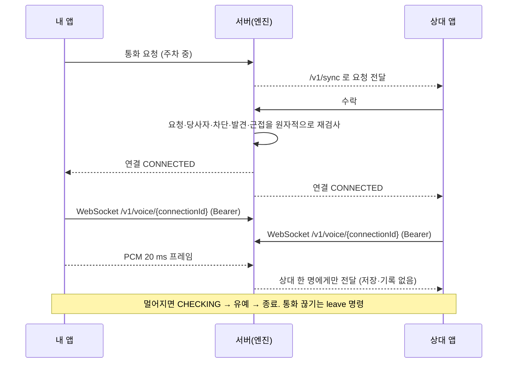

# 기술 개요

차연이 어떻게 만들어졌는지 한 문서로 정리했어요. 세부 규칙은 각 절의 링크를 따라가면 돼요. 2026-11-14, `feat/chayeon-v1` `3fd1de8` 기준이에요.

## 한눈에 보기

- **앱:** Android Automotive(Pleos Connect)용 Kotlin·Jetpack Compose 앱. 단일 Activity, 화면별 ViewModel과 불변 StateFlow 상태.
- **서버:** Ktor 단일 서버. 명령은 REST, 상태는 긴 폴링 동기화, 통화 음성은 인증 WebSocket 중계.
- **관계 규칙:** `core:engine`의 순수 Kotlin 상태 기계 하나를 서버와 `혼자 둘러보기`(기기 안 엔진)가 함께 실행해요. 두 모드의 동작이 갈라지지 않아요.
- **차량:** Pleos Vehicle SDK 2.3.2와 Android Car API로 주행 신호를 읽고, 원시 값은 기기 메모리에서만 다뤄요. 주행마다 파생 지표만 저장해요.
- **음성:** 실제 상대와는 16 kHz mono PCM을 서버가 두 참여자 사이에만 중계해요. 가상 상대는 미리 만든 음성 클립으로 말하고, 자동 연결 안내는 Pleos TextToSpeech(ON_DEVICE)로 말해요.

```mermaid
flowchart LR
  subgraph Car[차량 · Pleos Connect]
    VehicleSDK[Vehicle SDK 2.3.2\nCarPropertyManager\nCarUxRestrictionsManager]
    TTS[Pleos TextToSpeech 3.3.1\nON_DEVICE]
    subgraph App[차연 앱]
      Vehicle[data:vehicle\n주행 기록·점수 근거]
      Social[data:social\n기기 안 엔진 / 서버 연동]
      Voice[data:voice\n통화·오디오·데모 음성]
      Features[feature:meet · history · signature]
      AppWiring[app\n조립·자동 연결·집 보호]
    end
  end
  subgraph Server[심사용 서버]
    Ktor[Ktor\nREST · /v1/sync 긴 폴링 · /v1/voice WebSocket]
    Engine[core:engine\n관계 상태 기계]
    Store[(파일 저장\n0600 원자 쓰기)]
  end
  VehicleSDK --> Vehicle
  TTS --> Voice
  Vehicle --> AppWiring
  Social <--> Ktor
  Voice <--> Social
  Ktor --> Engine --> Store
  Features --> AppWiring
```

모듈 경계와 허용 의존 방향은 [아키텍처](architecture.md)에 있고, 빌드의 `verifyArchitecture`가 매번 검사해요.

## 핵심 흐름

### 1. 드라이브 프로필 (운전 점수)

1. `data:vehicle`이 Vehicle SDK·`CarPropertyManager`에서 기어, 속도, 브레이크, 조향 크기, 방향지시등, 크루즈, 벨트, 타이어, 연료·배터리, 충전 한도, 소모품 경고, 공조를 받아요. 지원하지 않거나 권한이 없는 신호는 `UNSUPPORTED`로 남기고 0으로 바꾸지 않아요.
2. `core:signature`의 `TripAccumulator`가 원시 값을 메모리에서만 다루며 특성별 지원 표본과 통과 표본을 셉니다. 주행이 끝나면 `DerivedTripMetrics`(특성별 표본 수와 비율)만 SQLite `drive-signature.db`에 저장해요.
3. 점수는 근거 창의 유효 주행(3분·2 km 이상, 내가 운전하지 않은 주행 제외)에서 `round(100 × Σ통과 ÷ Σ지원)`이에요. 유효 주행 3회부터 계산하고, 60점부터 `보여요`, 75점 `꾸준해요`, 90점 `시그니처` 단계예요.
4. 60점 이상이고 내가 공개를 켠 특성만 `PublicTrait(score)`로 서버와 상대에게 가요. 취향(긴 여정파, 밤 드라이브파)은 점수 없는 배지예요. 속도를 칭찬하는 특성은 없어요.

규칙 전체: [드라이브 시그니처](product/drive-signature.md)

### 2. 만남과 통화

- 연결이 되면 바로 통화가 시작돼요. 주행 중에는 상대의 칭호와 공개 점수 두 개, `음소거`, `통화 끊기`만 보여요.
- 서버 중계: 16 kHz mono PCM16, 20 ms/640 byte 프레임, 대기열 5프레임, 초당 50프레임 예산. 현재 연결의 두 당사자가 아니면 403이에요.
- 확인 중(CHECKING)·종료·집 보호·로그아웃에서는 녹음과 재생을 즉시 멈춰요.
- 가상 상대(혼자 둘러보기와 서버 모드의 DEMO_PEER)는 마이크와 WebSocket을 열지 않고, 세 문장을 20초 간격으로 말해요. 같은 연결이 확인 중에서 돌아오면 다음 문장부터 이어 가요. 클립 출처: [가상 상대 음성 클립](design/voice-assets.md)

계약: [공통 계약 · 음성 통화](contracts.md#음성-통화-계약)

### 3. 주행 중 연결과 자동 연결

`주행 중 연결` 설정은 `끄기`(기본) · `전화처럼 받기` · `조건에 맞으면 자동 연결`이에요. 조건은 특성별 최소 점수(60~100, 5점 단위)와 선택적인 `관심사가 하나 이상 겹치는 사람`이에요. 주차 중에만 바꿀 수 있어요.

`app`의 `AutoConnectCoordinator`가 1초마다 상태를 보고 다음 순서로 판단해요.

1. **실행 조건:** 주행 중(RESTRICTED), 집 보호 아님, 설정이 AUTO, 발견 ON, 진행 중인 연결 없음, 통화 종료 후 10분 대기 지남, 자동 연결 기록 저장 정상.
2. **받은 요청 먼저:** 만료되지 않은 받은 요청 중 조건에 맞는 사람을 자동 수락해요(미리 해 둔 동의). 조건에 맞지 않으면 전화처럼 받는 화면으로 넘어가요.
3. **보낸 요청이 대기 중이면 기다려요.** 대기 요청은 하나만 둬요.
4. **보낼 상대 고르기:** 조건에 맞는 후보 중 초과한 조건 수 → 겹치는 관심사 수 → id 순으로 한 명을 골라 자동 요청을 보내요. 같은 명령 ID로 재시도해서 중복 요청이 생기지 않아요. 서버가 거절하면(예: 동시에 서로 요청) 그 사람만 60초 뒤에 다시 시도해요.
5. **막는 규칙:** 거절·취소·만료·응답 불가가 된 요청의 상대, 그리고 통화가 끝난 상대는 **그날** 자동 연결에서 빠져요. 상대가 나에게 보냈다가 만료된 요청도 포함돼요. 차단한 사람은 항상 빠져요.
6. **안내:** 자동으로 이어진 연결은 Pleos 음성으로 `○○님과 연결됐어요`를 연결마다 한 번만 말해요.

기록(당일 제외 목록, 10분 대기 종료 시각, 재시도용 명령, 안내한 연결)은 계정별로 `noBackupFilesDir/automatic-connections`에 원자적으로 저장해요. 저장을 확인할 수 없으면 자동 실행을 막아요. 서버도 저장된 AUTO 동의와 공개 조건을 다시 검사하고, 서버가 상대를 골라 주지는 않아요.

### 4. 애프터와 아이디 교환

통화가 끝난 뒤 한쪽이 애프터를 신청하며 건넬 카카오톡·인스타그램 아이디를 고르고, 상대도 아이디를 골라 수락하는 순간에만 서로에게 보여요. 아이디는 공개 프로필, 후보, 요청, 기록, 알림, 로그에 들어가지 않아요. 관계 종료·차단·계정 삭제 뒤에는 명령 재시도 결과에도 남지 않아요. 주차 중(ALLOWED)에만 보이고, 카카오톡 링크는 만들지 않아요. 인스타그램 아이디는 QR로도 보여 줘요.

### 5. 집 보호 구역

집 위치는 기기 안 SQLite에 흔든 중심만 저장하고 서버로 보내지 않아요. 집 근처에서는 발견을 쉬고(서버에는 AWAY만 보냄), 이어져 있던 상대에게는 멀어져서 끝난 것과 같은 화면이 보여요. 자세한 판정: [아키텍처 · 기기 안의 집 보호 구역](architecture.md#기기-안의-집-보호-구역)

## 안전과 개인정보를 지키는 위치

| 규칙 | 지키는 곳 |
|---|---|
| 주행 중에는 탐색·전송·입력·설정 금지 | `DrivingStateProvider`: 신선한 P이고 UX 제한의 Requires DO=false일 때만 ALLOWED. 화면과 `data:social` 명령 직전에 다시 확인 |
| 속도 0이어도 D·N은 주행 중 | 같은 정책. 기어와 UX 제한으로만 판정 |
| 좌표·거리·방향·경로를 응답·화면·로그에 넣지 않음 | 엔진 상태에 좌표 없음, 합성 presence로 근접 판정, 집 보호는 기기 안 비교 |
| 원시 차량 신호는 기기 메모리에서만 | `TripAccumulator` → 파생 지표만 저장 |
| 공개 점수만 60~100으로 상대에게 | 앱 투영 + 서버 검증(범위 밖 거부) |
| 음성은 연결 두 당사자 사이에만, 저장·로그 없음 | 서버 `/v1/voice` 당사자 검사, 저장 모델·동기화 DTO에 음성 없음 |
| 연락처 아이디는 양쪽 수락 뒤에만 | `AfterRepository`와 엔진의 교환 상태 |
| VIN·CRN·번호판·차종을 읽지 않음 | `CarInfo.getVINInfo`/`getCRNInfo` 호출 없음 |
| 신원은 서버 인증 토큰으로만 | 요청 본문의 신원·동의 값을 믿지 않음 |

## Pleos·Android 플랫폼 사용

| 기능 | 사용 |
|---|---|
| Vehicle SDK 2.3.2 | 기어, 브레이크, 조향, 방향지시등, 크루즈, 벨트, 타이어, 연료·배터리, 충전 한도, 소모품, 공조. `check*Capabilities`로 지원 여부 확인 |
| `CarPropertyManager` | `PERF_VEHICLE_SPEED` (SDK에 속도 API가 없음) |
| `CarUxRestrictionsManager` | 주행 제한 판정 (권한 없이 변경 리스너와 현재 값) |
| TextToSpeech 3.3.1 `Mode.ON_DEVICE` | 자동 연결 안내, 가상 상대 클립 재생 실패 시 대체 발화. 일반 권한 `pleos.car.permission.TTS_SERVICE` |
| `AudioRecord`/`AudioTrack`, 오디오 포커스 | 통화 PCM 송수신, 내비게이션 안내는 덕킹으로 유지 |
| 포그라운드 서비스 | 주행 기록·발견·집 보호(dataSync, location), 통화(microphone 또는 mediaPlayback) |
| `LocationManager` | 집 보호 비교만. 서버로 보내지 않음 |

## 저장 위치

| 위치 | 내용 | 비고 |
|---|---|---|
| 기기 `drive-signature.db` (SQLite) | 주행별 파생 지표, 시그니처, 공개 설정, 집 보호 중심 | 원시 신호 없음 |
| 기기 `noBackupFilesDir/chayeon-social/*.json` | 세션, 설치별 비밀 값, 혼자 둘러보기 엔진 상태 | 원자 쓰기, 백업 제외 |
| 기기 `noBackupFilesDir/automatic-connections/` | 자동 연결 기록 | 계정 id의 SHA-256 파일명 |
| 서버 `CHAYEON_DATA_DIR` | 엔진 상태(프로필, 동의, 관계, 교환한 아이디, 토큰 digest) | 0600 원자 쓰기, 설정하지 않으면 메모리 |

앱 매니페스트는 `allowBackup=false`, `fullBackupContent=false`예요. 음성, 원시 차량 신호, 좌표는 어디에도 저장하지 않아요.

## 검증

| 항목 | 현재 |
|---|---|
| `python3 scripts/dev.py verify` | 구조 검사, 단위·서버·스크린샷 테스트, lint, 빌드. JUnit 1,075개, Python 도구 테스트 18개, Roborazzi 기준 이미지 485장 |
| 에뮬레이터 종단 검증 (`dev.py e2e`) | 릴리스 화면 체크 55, 디버그 62(차량 연결 해제·화면 꺼짐 중 집 보호·210초 실제 신호 주행 포함), 서버 모드 18(두 계정 PCM 중계, 제3자 거절, 연결 만료, 오프라인 복구) |
| 공개 서버 점검 | 두 계정 HTTPS 명령과 WSS 음성 양방향 100/100, 제3자 403 ([배포 안내](../deploy/README.md#공개-서버-점검)) |
| 화면 점검 | 에뮬레이터 흐름 46장과 상태 340장을 모은 검토 페이지(팀 내부) |

## 운영

심사 기간에는 팀 서버에서 Docker 컨테이너로 서버를 실행하고 Cloudflare 터널로 HTTPS와 WebSocket을 열어요. 환경 변수, 요청 제한, 정원, 백업과 초기화는 [배포 안내](../deploy/README.md)에 있어요. 제출 APK는 `CHAYEON_SERVER_URL=<공개 주소> python3 scripts/dev.py release`로 주소를 넣어 빌드해요.

## 알려진 한계

- 점수는 차 안의 앱이 계산하므로 변조된 앱이 높은 점수를 꾸밀 수 있어요. 자동 연결 조건도 이 점수를 믿어요. 공개 운영 전에는 서명된 차량 신호로 검증해야 해요.
- 근접은 합성 presence로 판정해요. 실제 위치 기반 근접과 실차, 실제 차량 스피커 출력, App Market 승인은 확인하지 못했어요.
- 통화 PCM은 방향당 약 256 kbps예요. Opus 압축은 후속 과제예요.

## 더 읽을 문서

- [아키텍처](architecture.md): 모듈, 의존 방향, 상태 전이, 차량 연동, 집 보호, 통화, 자동 연결
- [공통 계약](contracts.md): 엔진 규칙, 서버 경로, 화면별 계약, 음성·연락처·자동 연결 계약
- [배포 안내](../deploy/README.md): 서버 운영, 환경 변수, 제한, 점검
- [함께 개발하기](../CONTRIBUTING.md): 개발 환경, 검증, 에뮬레이터 주의
- [앱 통합 기록](../app/INTEGRATION.md): 기능별 통합과 검증 기록
- [제품 결정 기록](product/decisions.md), [경험 명세](product/experience-spec.md), [품질 기준](product/quality-bar.md)
